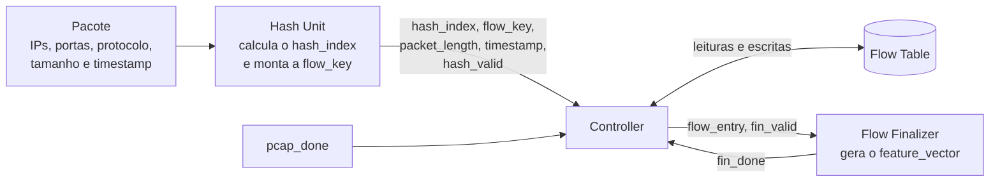
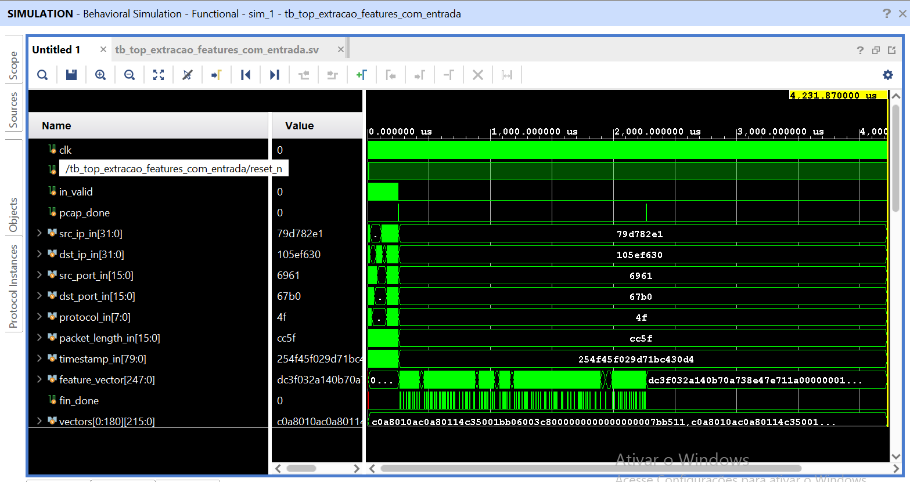
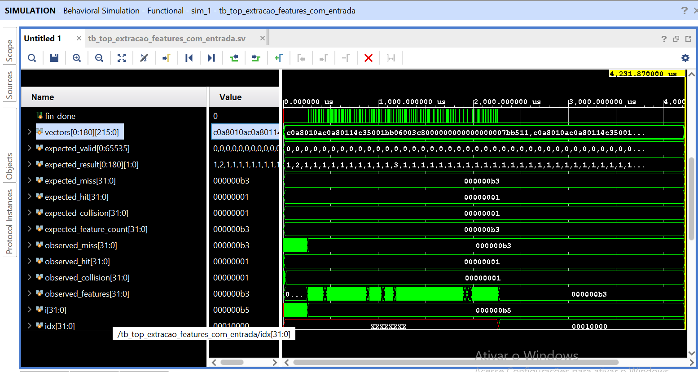
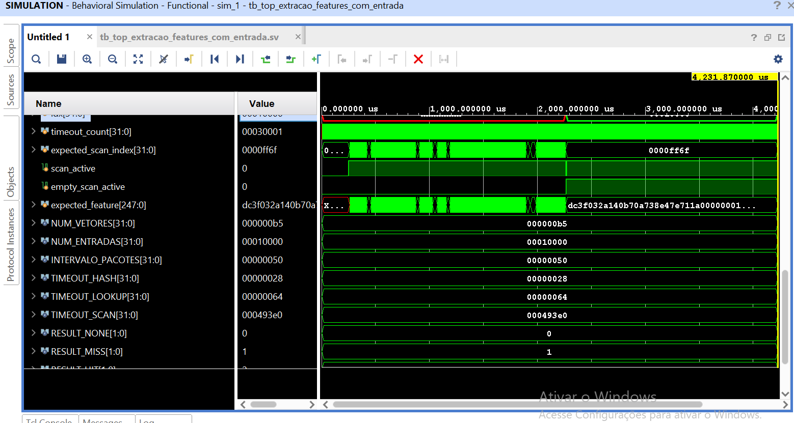
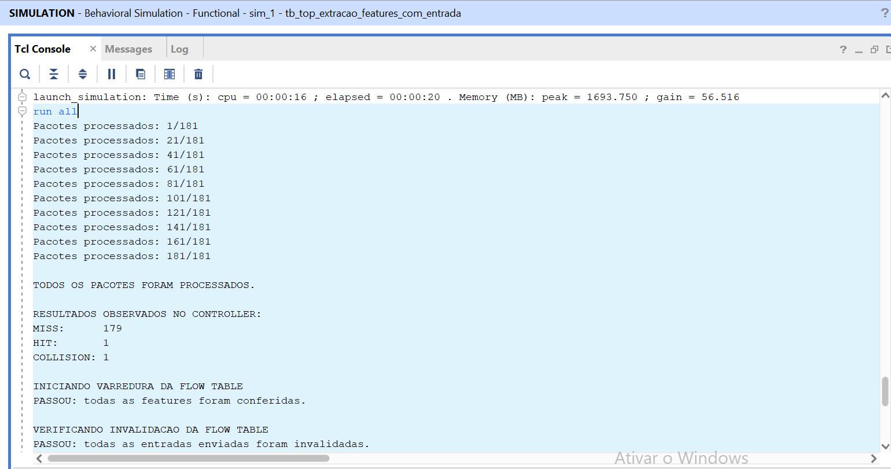
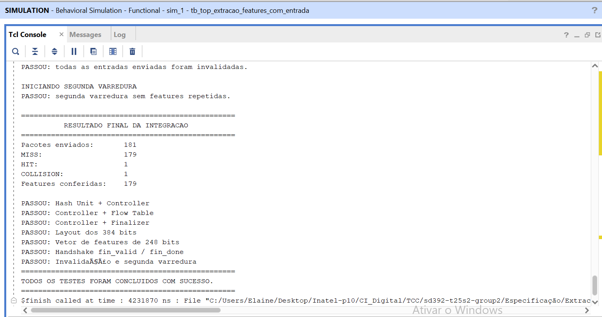

# Integração — Hash Unit + Controller + Flow Finalizer

Este documento descreve a integração das três etapas do caminho de dados e o teste que a validou:

- **2.4 — Hash Unit + Controller:** a saída da identificação do fluxo e do hash alimenta a entrada do Controller.
- **2.5 — Controller + Flow Finalizer:** o Controller entrega os registros dos fluxos ao Finalizer, que gera o `feature_vector`.

## 1. Resumo

| Item | Situação |
|---|---|
| Hash Unit conectada ao Controller (sinais, larguras e protocolo `valid`) | Integrada e validada |
| Controller captura `hash_index`, `flow_key`, `packet_length` e `timestamp` corretamente | Validado em 181 pacotes |
| Início da FSM só em `IDLE`, com `start` em 1 ciclo | Validado |
| MISS, HIT e COLLISION com entradas conhecidas | Validados contra um modelo de referência independente |
| Controller conectado ao Flow Finalizer (`flow_entry`, `fin_valid`, `fin_done`) | Integrado e validado |
| Layout do `flow_entry` (384 bits) interpretado corretamente pelo Finalizer | Validado em 179 registros |
| `feature_vector` de 248 bits (chave 104 + pacotes 32 + bytes 32 + duração 80) | Validado em 179 vetores |
| Vários registros consecutivos, sem duplicatas | Validado (179 registros em sequência) |
| Invalidação das entradas enviadas e segunda varredura vazia | Validadas |
| Falhas de integração separadas de falhas internas dos módulos | Mensagens de erro por camada; testes unitários mantidos |

**Resultado do teste:** 181 pacotes processados (179 MISS, 1 HIT, 1 COLLISION), 179 features conferidas, `$finish` em 4.231.870 ns, sem nenhum erro.

---

## 2. Arquitetura integrada



O módulo topo é o `top_extracao_features_com_entrada`. Ele contém quatro blocos:

| Bloco | Instância | Função |
|---|---|---|
| Identificação + Hash | `u_fiu_hash_top` | Recebe os campos do pacote, monta a `flow_key` de 104 bits e calcula o `hash_index` (CRC16) |
| Controller | `u_controller` | Consulta e atualiza a Flow Table, classifica MISS/HIT/COLLISION e executa a varredura |
| Flow Table | `u_flow_table` | Memória de 65.536 entradas × 16 palavras de 32 bits (1.048.576 palavras, endereço de 20 bits) |
| Flow Finalizer | `u_finalizer` | Recebe cada registro de fluxo e gera o `feature_vector` |

**Parâmetros do topo** (repassados ao Controller): `INVALIDATE_AFTER_SEND` (padrão 1) e `SCAN_ENTRIES` (padrão 65536).

**Polaridade do reset.** O Hash Unit usa `reset_n` (ativo em nível baixo). Controller, Flow Table e Finalizer usam `rst` (ativo em nível alto, síncrono). O topo faz a conversão com `rst = ~reset_n`.

### 2.1. Entrada do topo

| Sinal | Largura | Descrição |
|---|---:|---|
| `src_ip_in` | 32 bits | IP de origem |
| `dst_ip_in` | 32 bits | IP de destino |
| `src_port_in` | 16 bits | Porta de origem |
| `dst_port_in` | 16 bits | Porta de destino |
| `protocol_in` | 8 bits | Protocolo |
| `packet_length_in` | 16 bits | Tamanho do pacote em bytes |
| `timestamp_in` | 80 bits | Timestamp do pacote |
| `in_valid` | 1 bit | Os campos acima são válidos |
| `pcap_done` | 1 bit | Fim dos dados; dispara a varredura |

A `flow_key` de 104 bits é a concatenação `{src_ip, dst_ip, src_port, dst_port, protocol}` (32 + 32 + 16 + 16 + 8).

### 2.2. Saída do topo

| Sinal | Largura | Descrição |
|---|---:|---|
| `feature_vector` | 248 bits | Features do fluxo |
| `fin_done` | 1 bit | Pulso de 1 ciclo: há um `feature_vector` novo (também é a confirmação que volta ao Controller) |

---

## 3. Interfaces conectadas

### 3.1. Hash Unit → Controller (atividade 2.4)

O protocolo é o acordado: **`valid` sem `ready`**. A Hash Unit ativa `hash_valid` junto com os dados, e o Controller os captura quando `hash_valid` está ativo e ele está em `IDLE`.

| Sinal | Largura | Origem → Destino |
|---|---:|---|
| `hash_index` | 16 bits | Hash Unit → Controller |
| `flow_key` | 104 bits | Hash Unit → Controller |
| `packet_length` | 16 bits | Hash Unit → Controller |
| `timestamp` | 80 bits | Hash Unit → Controller |
| `hash_valid` | 1 bit | Hash Unit → Controller |

**Regra de captura (Controller).** O sinal interno `start = (state == IDLE) && hash_valid` dura 1 ciclo e só existe com o Controller livre. Um `hash_valid` que chega com o Controller ocupado não é capturado, e uma nova captura só é aceita depois que `hash_valid` volta a zero.

### 3.2. Controller ↔ Flow Table

`rd_en`, `rd_addr[19:0]`, `rd_data[31:0]`, `rd_valid` para leitura e `wr_en`, `wr_addr[19:0]`, `wr_data[31:0]`, `wr_done` para escrita. A resposta chega 1 ciclo depois do pedido, e o Controller aguarda `rd_valid` e `wr_done` em vez de contar ciclos.

### 3.3. Controller → Flow Finalizer (atividade 2.5)

| Sinal | Largura | Direção | Função |
|---|---:|---|---|
| `flow_entry` | 384 bits | Controller → Finalizer | Registro do fluxo (W1–W12) |
| `fin_valid` | 1 bit | Controller → Finalizer | Há um registro disponível em `flow_entry` |
| `fin_done` | 1 bit | Finalizer → Controller (e saída do topo) | O Finalizer terminou o registro |

**Handshake (sem `ready`).** O `fin_done` do Finalizer funciona como `ready`: quando ele sinaliza que terminou de gerar o vetor, o Controller entrega o próximo registro.

1. O Controller lê um fluxo válido da Flow Table, monta o `flow_entry` e ativa `fin_valid`.
2. O `flow_entry` permanece estável enquanto `fin_valid` está ativo.
3. O Finalizer processa o registro e gera `fin_done` em **um único pulso**.
4. O Controller vê o `fin_done`, baixa `fin_valid`, espera `fin_done` voltar a zero, escreve `W0 = 0` (invalida a entrada) e passa para a entrada seguinte.

O Finalizer processa o registro uma única vez enquanto `fin_valid` estiver ativo (controle `fin_seen`). Isso é essencial: se `fin_done` durasse 2 ciclos, a testbench que coleta um vetor por ciclo com `fin_done = 1` receberia cada fluxo em duplicata.

---

## 4. Organização dos dados

### 4.1. `flow_entry` (Controller → Finalizer): 384 bits = W1 a W12

O W0 (`valid`) não é enviado.

| Palavra | Bits | Campo |
|---|---|---|
| W1–W4 | `[127:0]` | `flow_key` (104 bits úteis; em W4 só os bits [7:0]) |
| W5 | `[159:128]` | `packet_count` |
| W6 | `[191:160]` | `byte_count` |
| W7–W9 | `[287:192]` | `first_timestamp` (80 bits) |
| W10–W12 | `[383:288]` | `last_timestamp` (80 bits) |

### 4.2. `feature_vector` (saída): 248 bits

| Bits | Campo | Largura | Origem |
|---|---|---:|---|
| `[247:144]` | `flow_key` | 104 bits | W1–W4 |
| `[143:112]` | `packet_count` | 32 bits | W5 |
| `[111:80]` | `byte_count` | 32 bits | W6 |
| `[79:0]` | `duration` | 80 bits | `last_timestamp − first_timestamp` |

O Finalizer monta os timestamps de 80 bits a partir de W7–W9 e W10–W12 e calcula a duração como a diferença dos dois.

---

## 5. Como o dado percorre o sistema

**Para cada pacote:**

1. A testbench (ou o módulo anterior) ativa `in_valid` por 1 ciclo com os campos do pacote.
2. O Hash Unit calcula o `hash_index` e monta a `flow_key`, e ativa `hash_valid` com os cinco sinais de saída.
3. Com o Controller em `IDLE`, `start` pulsa e os dados são capturados nos registradores internos.
4. O Controller lê W0–W4 da entrada `hash_index`, classifica o resultado e executa: **MISS** escreve o registro novo (13 escritas), **HIT** atualiza contadores e último timestamp (2 leituras e 5 escritas) e **COLLISION** preserva a entrada e incrementa `collision_count`.
5. `lookup_done` pulsa ao terminar, e o Controller volta a `IDLE` quando `hash_valid` está em zero.

**No fim dos dados (`pcap_done`):**

6. O Controller percorre as entradas de 0 a 65535, lê W0 e, nas entradas válidas, lê W1–W12 e entrega o registro ao Finalizer.
7. Cada registro gera um `feature_vector` com `fin_done` em pulso único.
8. Cada entrada enviada é invalidada (`W0 = 0`). Ao fim, o sinal interno `scan_done` pulsa.

---

## 6. Testbench de integração

**Arquivo:** `tb_top_extracao_features_com_entrada.sv` (topo da simulação: `tb_top_extracao_features_com_entrada`).

### 6.1. Entradas conhecidas: `hash_vectors.mem`

O arquivo tem **181 vetores** de 216 bits. Cada vetor traz um pacote e o hash esperado:

| Bits | Conteúdo |
|---|---|
| `[215:112]` | `flow_key` (`src_ip`, `dst_ip`, `src_port`, `dst_port`, `protocol`) |
| `[111:96]` | Tamanho do pacote |
| `[95:16]` | Timestamp |
| `[15:0]` | CRC16 esperado (`hash_index`) |

### 6.2. Modelo de referência independente

Antes de simular, a testbench percorre os 181 vetores e calcula, **sem usar nenhum sinal do Controller**, o que deve acontecer:

- Para cada pacote, se a entrada ainda não foi vista → **MISS** (cria o fluxo); se foi vista com a mesma chave → **HIT** (soma 1 pacote e os bytes, atualiza o último timestamp); se foi vista com chave diferente → **COLLISION** (a entrada original não muda).
- O estado final de cada entrada: contagem de pacotes e de bytes, primeiro e último timestamp.
- Resultado esperado do conjunto: **179 MISS, 1 HIT, 1 COLLISION e 179 fluxos** (features).

A testbench ainda confere que o conjunto de vetores cobre os três casos (se faltasse algum, o teste pararia).

### 6.3. Sequência por pacote

Para cada um dos 181 vetores, a testbench:

1. Aplica os campos do pacote com `in_valid` em 1 ciclo.
2. Espera `hash_valid` (limite de 40 ciclos) e confere a saída da Hash Unit.
3. Confere que o Controller iniciou a captura (`start = 1`) e que registrou os dados corretos.
4. Espera `lookup_done` (limite de 100 ciclos) e confere a classificação.
5. Aguarda 80 ciclos antes do próximo pacote. O intervalo é conservador: não há `ready` nem FIFO, então um novo pacote com o Controller ocupado seria perdido.

### 6.4. O que cada verificação prova

| Etapa | Verificação | Se falhar, o problema está em |
|---|---|---|
| Hash Unit | `hash_valid` em até 40 ciclos; `hash_index` igual ao CRC16 esperado; `flow_key`, `packet_length` e `timestamp` iguais ao vetor | Hash Unit (`ERRO HASH`, `ERRO CRC`) |
| Hash Unit → Controller | `start = 1` quando `hash_valid` chega; após a borda, `base_addr[19:4]`, `flow_key_reg`, `packet_length_reg` e `timestamp_reg` iguais aos dados | Integração ou captura do Controller (`ERRO INTEGRACAO`, `ERRO CONTROLLER`) |
| Controller | `lookup_done` em até 100 ciclos; `lookup_result` igual ao do modelo | Lógica do Controller (`ERRO CLASSIFICACAO`) |
| Contagens | Quantidades de MISS, HIT e COLLISION iguais às do modelo; `collision_count` interno igual ao de COLLISION | Controller |
| Varredura | A cada `fin_done`, `feature_vector` igual ao esperado (chave, pacotes, bytes e duração), na ordem crescente dos índices; nenhuma feature a mais ou a menos | Controller, Finalizer ou layout (`ERRO FEATURE`) |
| Invalidação | `W0 = 0` em todas as entradas enviadas | Controller |
| 2ª varredura | Nenhum `fin_done`: não há reenvio | Controller |

As mensagens de erro identificam a camada, o que ajuda a **separar falhas de integração de falhas internas**. Os testes unitários de cada módulo continuam independentes (o do Controller é o `tb_controller_unit`, e o do Finalizer, o `tb_flow_finalizer_v3`).

### 6.5. Varreduras

- **Primeira varredura:** disparada por um pulso de `pcap_done` depois de todos os pacotes. Conferiu as 179 features, uma a uma, comparando com o modelo e na ordem dos índices. O limite de espera por `scan_done` é de 300.000 ciclos.
- **Invalidação:** depois da varredura, o W0 de cada uma das 179 entradas precisa estar em zero.
- **Segunda varredura:** um novo `pcap_done`. Como as entradas foram invalidadas, nenhum `fin_done` pode ocorrer; se ocorresse, a testbench acusaria erro.

---

## 7. Resultados

```
MISS:      179
HIT:       1
COLLISION: 1
Features conferidas: 179
$finish called at time : 4231870 ns
```

| Verificação | Esperado | Obtido |
|---|---:|---:|
| Pacotes enviados | 181 | 181 |
| MISS | 179 | 179 |
| HIT | 1 | 1 |
| COLLISION | 1 | 1 |
| Features (uma por fluxo) | 179 | 179 |
| Entradas invalidadas | 179 | 179 |
| Features na segunda varredura | 0 | 0 |

**Coerência dos números.** Cada MISS cria uma entrada nova, e HIT e COLLISION não criam nenhuma, então 179 MISS levam a 179 features. A soma 179 + 1 + 1 fecha em 181 pacotes.

**Duração da simulação.** Os 4.231.870 ns correspondem a cerca de 423 mil ciclos. Cada varredura percorre as 65.536 entradas, e uma entrada vazia leva 3 ciclos (pedido de leitura, espera da resposta e passagem à próxima): são cerca de 196.600 ciclos por varredura. Isso aparece na própria simulação: ao fim da segunda varredura, o contador de espera da testbench (`timeout_count`) marca 196.609 ciclos. O restante do tempo vem dos 181 pacotes e das 179 entregas ao Finalizer.

---

## 8. Evidências



**Entradas e saídas do topo.** Os 181 pacotes entram com pulsos de `in_valid` no início da simulação. Depois de todos os pacotes, um pulso de `pcap_done` inicia a primeira varredura, e é nesse intervalo que `fin_done` pulsa várias vezes e o `feature_vector` muda a cada fluxo entregue. Um segundo pulso de `pcap_done`, perto de 2 ms, inicia a segunda varredura: depois dele **não há mais pulsos de `fin_done`**, ou seja, nenhum fluxo foi reenviado.



**Modelo de referência e contadores.** `expected_result` mostra a classificação prevista para cada pacote (1 = MISS, 2 = HIT, 3 = COLLISION). `expected_miss`, `expected_hit`, `expected_collision` e `expected_feature_count` valem `0xB3` (179), 1, 1 e `0xB3`; `observed_miss`, `observed_hit`, `observed_collision` e `observed_features` chegam aos mesmos valores. O contador `i` termina em `0xB5` (181).



**Controle da varredura e constantes.** `scan_active` fica ativo nas duas varreduras e `empty_scan_active` só na segunda (nela, qualquer `fin_done` seria erro). `expected_scan_index` termina em `0xFF6F`, o que mostra que a varredura conferiu fluxos até perto do fim da tabela (índices próximos de 65.390). As constantes do teste aparecem na parte de baixo: 181 vetores, 65.536 entradas, intervalo de 80 ciclos entre pacotes, limites de 40 ciclos para o hash e de 100 para o lookup, e de 300.000 ciclos para a varredura. O `timeout_count` de `0x30001` (196.609) é a duração medida da segunda varredura.



**Console (1/2).** Progresso dos 181 pacotes, os resultados observados no Controller (179 MISS, 1 HIT e 1 COLLISION), a primeira varredura com `PASSOU: todas as features foram conferidas` e a verificação da invalidação.



**Console (2/2).** Segunda varredura sem features repetidas, o relatório final da integração (181 pacotes, 179 features conferidas), a lista de etapas aprovadas e `TODOS OS TESTES FORAM CONCLUIDOS COM SUCESSO` com `$finish` em 4.231.870 ns. A mensagem sobre invalidação aparece com acentos quebrados por causa da codificação do console; o conteúdo do teste não é afetado.

---

## 9. Atividades

### 9.1. Atividade 2.4: Hash Unit + Controller

| Atividade | Como foi atendida |
|---|---|
| Conectar a saída da Hash Unit à entrada do Controller (sinais, larguras e protocolo `valid`) | `hash_index` 16, `flow_key` 104, `packet_length` 16, `timestamp` 80 e `hash_valid`, no módulo topo |
| Verificar se o Controller captura `hash_index`, `flow_key` e os demais campos | Para cada um dos 181 pacotes, comparação dos registradores internos do Controller com o vetor de entrada |
| Validar a sequência de recepção e o início da FSM, com a regra de captura | `start = 1` conferido a cada pacote; captura só em `IDLE`; pacotes enviados em 1 ciclo de `in_valid` |
| Testes integrados com entradas conhecidas (HIT, MISS e COLLISION) | 181 vetores: 179 MISS, 1 HIT e 1 COLLISION, conferidos contra o modelo de referência |
| Separar falhas de integração de falhas internas | Mensagens de erro por camada; testes unitários independentes mantidos |

### 9.2. Atividade 2.5: Controller + Flow Finalizer

| Atividade | Como foi atendida |
|---|---|
| Conectar a entrega de registros do Controller à entrada do Finalizer | `flow_entry`, `fin_valid` e `fin_done` no módulo topo |
| Definir e validar a sinalização de registro disponível e de recepção, sem `ready` | `fin_valid` mantido até o `fin_done`; `fin_done` em pulso único por registro |
| Correspondência entre os campos do registro e a interpretação do Finalizer | Layout `flow_entry` W1–W12 conferido em 179 registros |
| Registros conhecidos com `packet_count`, `byte_count`, timestamps e duração | Cada `feature_vector` comparado com o valor calculado pelo modelo de referência |
| Largura e composição do `feature_vector` (104 + 32 + 32 + 80 = 248) | Conferidas em todos os vetores |
| Comportamento com mais de um registro consecutivo e necessidade de controle adicional | Ver a seção 10 |

---

## 10. Comportamento com registros consecutivos

Foram entregues **179 registros em sequência**, sem nenhuma perda nem duplicata (uma feature excedente ou fora de ordem daria erro).

**Controle adicional?** Com o Finalizer atual (resposta em 1 ciclo), **não é preciso nenhum controle além do já existente**: o Controller entrega um registro, espera o `fin_done` e só então avança. Dois cuidados ficam registrados:

- O `fin_done` precisa ser **um pulso único por registro**. Uma versão anterior do Finalizer gerava `fin_done` por 2 ciclos (porque ainda via `fin_valid` ativo no ciclo seguinte), o que duplicaria cada fluxo na saída. O controle `fin_seen` do Finalizer atual resolve isso.
- Se o Finalizer passar a levar mais de 1 ciclo por registro, o Controller já espera o `fin_done`, então o handshake continua válido. A varredura apenas fica mais lenta.

---

## 11. Limitações e recomendações

**Cobertura do teste**

- **Quase todos os fluxos têm um único pacote.** Dos 179 fluxos, 178 têm `packet_count = 1`, o `byte_count` de um pacote e duração zero. Apenas um fluxo tem 2 pacotes. Isso valida a estrutura e o layout, mas valida pouco o **cálculo** de soma de bytes, contagem acima de 1 e duração diferente de zero. Recomenda-se acrescentar ao arquivo de vetores fluxos com 5 a 20 pacotes, timestamps maiores que 2³² e que 2⁴⁸ (para exercitar os 80 bits) e mais pares de colisão.
- **Um único HIT e uma única COLLISION.** Provam o caminho, mas não o acúmulo do `collision_count` nem vários descartes seguidos.
- **Intervalo de 80 ciclos entre pacotes.** O teste nunca envia pacotes mais próximos do que o Controller consegue processar (cerca de 40 ciclos para um MISS, 27 para um HIT e 13 para uma COLLISION, com memória de 1 ciclo). O descarte de pacotes com o Controller ocupado é verificado no teste unitário, mas não na integração. Vale combinar com a equipe a taxa máxima de pacotes que a Hash Unit pode entregar e incluir um teste de rajada.

**Contrato e documentação**

- **Polaridade do reset:** Hash Unit com `reset_n` (nível baixo) e os demais com `rst` (nível alto). Funciona com a conversão do topo, mas convém registrar no contrato ou unificar.
- **Mensagens finais do teste:** as linhas `PASSOU: ...` do resumo são impressas sem condição própria; elas só aparecem porque nenhum erro parou a simulação antes. Convém evitar caracteres acentuados nas mensagens para não quebrar a codificação do console.

**Operação contínua**

- Cada varredura leva cerca de 2 ms a 100 MHz e é **bloqueante**: pacotes que chegam durante ela se perdem. O esquema de varredura única com `pcap_done` serve ao fluxo de teste com arquivo; no sistema contínuo é preciso definir quando um fluxo é finalizado e como não perder pacotes.

**Implementação**

- A Flow Table de 4 MiB (cerca de 33,5 Mb) é adequada para simulação, mas não cabe na memória interna de uma FPGA pequena como a `xc7z010`. Antes de sintetizar o topo, é preciso reduzir a tabela ou usar memória externa.

---

## 12. Como executar

| Arquivo | Função |
|---|---|
| `top_extracao_features_com_entrada.sv` | Módulo topo (Hash Unit + Controller + Flow Table + Finalizer) |
| `controller.sv`, `flow_table.sv`, `flow_finalizer_v3.sv` | Módulos integrados |
| módulos da Hash Unit (`fiu_hash_top` e dependências) | Identificação do fluxo e cálculo do hash |
| `tb_top_extracao_features_com_entrada.sv` | Testbench de integração |
| `hash_vectors.mem` | 181 vetores de entrada e hash esperado |


