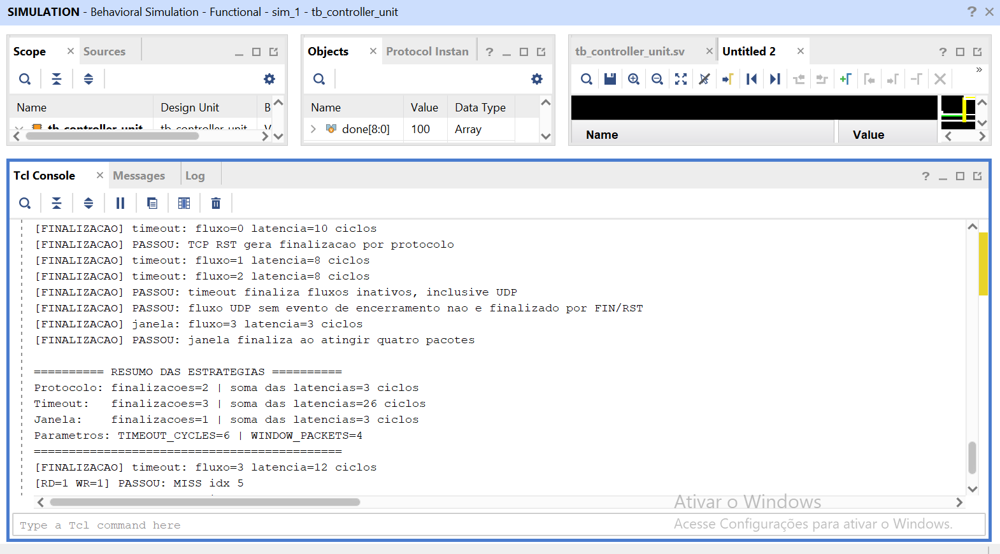

# Controller — Avaliação de estratégias de finalização dos fluxos

Este documento apresenta a avaliação de três alternativas para determinar quando um fluxo deve ser finalizado e encaminhado ao **Flow Finalizer** para geração do vetor de features:

- **Finalização por protocolo:** identificação dos flags TCP FIN/RST.
- **Finalização por timeout:** encerramento após um período sem receber pacotes.
- **Finalização por janela de pacotes:** encerramento após atingir uma quantidade definida de pacotes.

A avaliação foi realizada por meio de um modelo comportamental no `tb_controller_unit`, mantendo os testes existentes do Controller.

## 1. Contexto: mecanismo atual do Controller

Na implementação RTL atual, a finalização dos fluxos é iniciada pelo sinal `pcap_done`. Quando esse sinal indica o fim da captura, o Controller percorre a Flow Table, identifica as entradas válidas e encaminha seus registros ao Flow Finalizer.

O envio utiliza os sinais `fin_valid` e `fin_done`. Após a confirmação do Finalizer, a entrada correspondente pode ser invalidada para evitar que o mesmo fluxo seja enviado novamente em uma varredura posterior.

Portanto, o mecanismo atualmente implementado é baseado no **fim global da captura**. As estratégias por protocolo, timeout e janela de pacotes foram avaliadas como alternativas para uma futura evolução da finalização individual dos fluxos; elas ainda não estão integradas ao Controller RTL.

## 2. Estratégias avaliadas

### 2.1. Finalização por protocolo (TCP FIN/RST)

**Identificação da condição**

O fluxo é considerado candidato à finalização quando o Parser identifica os flags FIN ou RST no cabeçalho TCP. FIN sinaliza o encerramento ordenado de uma conexão, enquanto RST indica uma interrupção/reset da conexão.

**Informações e estados adicionais**

- Extração dos flags FIN e RST pelo Parser.
- Transporte desses flags até o Controller.
- Identificação da entrada correspondente na Flow Table.
- Estado ou sinal de controle para solicitar a finalização do fluxo.

Para uma implementação mais completa, também deve ser considerada a particularidade do encerramento TCP em cada direção da comunicação: a recepção de um FIN não significa necessariamente que os dois sentidos já foram encerrados.

**Impacto no Controller**

Complexidade média. O Controller precisaria tratar o evento de encerramento e solicitar a leitura e o envio da entrada específica ao Finalizer. Isso exigiria adaptar a interface com o Parser e complementar o mecanismo atual, que realiza uma varredura global após `pcap_done`.

**Impacto na latência**

A decisão pode ocorrer logo após a identificação do FIN/RST, sem aguardar um período de inatividade ou uma quantidade adicional de pacotes. Nos testes comportamentais, as latências observadas foram de 2 e 1 ciclos.

**Limitações**

- Aplicável diretamente apenas a TCP.
- UDP não possui flags FIN/RST.
- Uma conexão interrompida sem evento FIN/RST pode não ser finalizada por esse mecanismo.
- Um FIN pode encerrar apenas uma direção da comunicação.

### 2.2. Finalização por timeout

**Identificação da condição**

O fluxo é finalizado quando permanece sem receber novos pacotes durante um intervalo configurado. A chegada de um novo pacote atualiza a informação de atividade do fluxo.

**Informações e estados adicionais**

- Timestamp da última atividade ou contador de inatividade por fluxo.
- Referência temporal ou contador global para medir o tempo decorrido.
- Limite de timeout configurável.
- Estado que indique se o fluxo está ativo ou aguardando expiração.

**Impacto no Controller**

Complexidade alta em comparação às outras alternativas. O Controller precisa acompanhar a inatividade de vários fluxos e identificar quais ultrapassaram o limite. Isso pode exigir uma varredura periódica da Flow Table ou uma estrutura específica para gerenciar temporizadores. Também é necessário encaminhar cada fluxo expirado ao Finalizer e evitar finalizações duplicadas.

**Impacto na latência**

A geração das features fica condicionada ao período de timeout. Quanto maior o limite configurado, maior o atraso até que o fluxo seja considerado inativo. Nos testes, com `TIMEOUT_CYCLES = 6`, os eventos observados ocorreram após 8, 10 e 12 ciclos, conforme o instante de atividade de cada fluxo e a contagem do modelo.

**Limitações**

- Um timeout curto pode encerrar fluxos que apresentam pausas legítimas.
- Um timeout longo aumenta a latência de geração das features.
- Exige estado adicional por fluxo e lógica de monitoramento.
- A escolha do intervalo influencia diretamente o comportamento do sistema.

### 2.3. Finalização por janela de pacotes

**Identificação da condição**

O fluxo é finalizado quando atinge uma quantidade previamente definida de pacotes recebidos. O contador é atualizado a cada pacote associado ao fluxo.

**Informações e estados adicionais**

- Contador de pacotes por fluxo.
- Limite configurável de pacotes por janela.
- Estado ou sinal que indique que o limite foi atingido e que o fluxo está pronto para finalização.

**Impacto no Controller**

Complexidade baixa a média. A lógica principal consiste em atualizar o contador, comparar seu valor com o limite e solicitar a finalização da entrada correspondente. Assim como nas outras estratégias individuais, é necessário adaptar o caminho atual de envio ao Finalizer.

**Impacto na latência**

A latência depende da taxa de chegada dos pacotes. Fluxos ativos atingem o limite mais rapidamente, enquanto fluxos com poucos pacotes podem demorar para completar a janela. No teste, com `WINDOW_PACKETS = 4`, a decisão ocorreu 3 ciclos após o início da contagem considerado pelo modelo.

**Limitações**

- Atingir o limite não significa que a comunicação foi realmente encerrada.
- Um fluxo ainda ativo pode ser finalizado ao completar a janela.
- Fluxos com baixa atividade podem demorar muito para atingir o limite.
- O tamanho da janela influencia a quantidade de tráfego representada em cada vetor de features.

## 3. Comparação das estratégias

| Critério | Protocolo (FIN/RST) | Timeout | Janela de pacotes |
|---|---|---|---|
| Condição | Evento TCP FIN/RST | Ausência de pacotes por um intervalo | Quantidade de pacotes atingida |
| Estado adicional | Flags TCP e controle de finalização | Timestamp/contador de inatividade por fluxo | Contador de pacotes por fluxo |
| Complexidade estimada | Média | Alta | Baixa a média |
| Latência esperada | Baixa após o evento | Depende do timeout | Depende da taxa de pacotes |
| Suporte a UDP | Não | Sim | Sim |
| Limitação principal | Depende de evento TCP | Atraso e custo de monitoramento | Não representa necessariamente o encerramento real |

## 4. Testes comportamentais

Foi acrescentado ao `tb_controller_unit` um ambiente de avaliação das políticas de finalização. O modelo recebe estímulos de pacotes e verifica se cada estratégia gera o evento de finalização nas condições esperadas.

Os cenários avaliados foram:

1. TCP com encerramento por FIN.
2. TCP com encerramento por RST.
3. Fluxo UDP finalizado após período de inatividade.
4. Fluxo UDP finalizado ao atingir quatro pacotes.
5. Verificação de que um fluxo UDP sem evento de encerramento não é finalizado pela política FIN/RST.

Os parâmetros utilizados foram:

- `TIMEOUT_CYCLES = 6`
- `WINDOW_PACKETS = 4`

**Importante:** esse ambiente é um modelo comportamental independente da lógica de finalização do Controller RTL. Portanto, os resultados validam o comportamento das regras avaliadas no testbench, mas não comprovam que as três políticas já estejam implementadas ou integradas ao Controller, à Flow Table e ao Finalizer.

## 5. Resultados da simulação

O log apresentou os seguintes eventos:

| Estratégia | Eventos de finalização observados | Latências observadas | Soma das latências |
|---|---:|---|---:|
| Protocolo | 2 | 2 e 1 ciclos | 3 ciclos |
| Timeout | 4 | 10, 8, 8 e 12 ciclos | 38 ciclos |
| Janela de pacotes | 1 | 3 ciclos | 3 ciclos |

**Figura 1 —** Saída do console da simulação com os eventos de finalização, latências e resumo das estratégias.

**Observação sobre o resumo do console:** o resumo impresso no log aparece antes do último evento de timeout. Por isso, ele mostra inicialmente 3 finalizações e soma de 26 ciclos. Logo depois, é exibido mais um evento de timeout, do fluxo 3, com latência de 12 ciclos. Considerando todo o log, são 4 eventos e soma de 38 ciclos para timeout.

As latências representam o tempo até a decisão de finalização dentro do modelo comportamental. Não representam o tempo completo de leitura da Flow Table, handshake com o Finalizer ou geração do vetor de features no sistema integrado. Também não devem ser comparadas como medições de desempenho de hardware, pois cada política possui uma condição de disparo diferente.

Durante a mesma execução, os testes existentes de MISS, HIT e COLLISION do Controller também apresentaram mensagens de aprovação.

## 6. Relação com a implementação atual

A avaliação evidencia que a adoção de qualquer uma das três estratégias exigiria mudanças no mecanismo atual de finalização:

- **Protocolo:** acrescentar os flags TCP à interface do Controller e permitir solicitar a finalização da entrada identificada.
- **Timeout:** armazenar e monitorar a última atividade de cada fluxo, identificando entradas cujo tempo de inatividade ultrapasse o limite.
- **Janela de pacotes:** manter um contador por fluxo e solicitar a finalização quando a quantidade configurada for atingida.

Nas três alternativas, o Controller precisaria coordenar a leitura da entrada correspondente na Flow Table e seu envio ao Finalizer. Também seria necessário controlar o estado da entrada para impedir que um mesmo fluxo fosse enviado mais de uma vez.

A implementação atual, baseada em `pcap_done`, continua adequada ao fluxo de captura utilizado nos testes integrados, mas não realiza a finalização individual dos fluxos durante uma captura contínua.

## 7. Conclusão

A avaliação demonstrou que as três estratégias podem determinar condições de finalização distintas, cada uma com vantagens e limitações. A finalização por protocolo apresenta baixa latência após eventos TCP FIN/RST, mas não atende diretamente UDP. O timeout atende TCP e UDP, porém exige monitoramento temporal por fluxo e aumenta o tempo de espera. A janela de pacotes possui lógica de controle mais simples, mas não garante que o fluxo tenha sido efetivamente encerrado.

Considerando a arquitetura desenvolvida, a finalização atual por `pcap_done` realiza uma varredura da Flow Table e encaminha as entradas válidas ao Flow Finalizer. Assim, os testes comportamentais complementam a validação do Controller ao comparar alternativas para uma futura evolução, sem alterar ou atribuir ao RTL funcionalidades que ainda não foram implementadas.

Uma possibilidade futura é utilizar uma estratégia híbrida, combinando FIN/RST para fluxos TCP com timeout como mecanismo complementar para fluxos que não apresentem um evento explícito de encerramento. Essa decisão deverá considerar a complexidade de hardware, a latência desejada e a representatividade das features geradas.

## 8. Arquivos relacionados

| Arquivo | Descrição |
|---|---|
| `tb_controller_unit.sv` | Testbench com os testes existentes do Controller e o ambiente de avaliação comportamental das estratégias |
| `controller.sv` | Implementação RTL do Controller |
| `latencia.png` | Evidência do console da simulação e dos resultados das estratégias |
