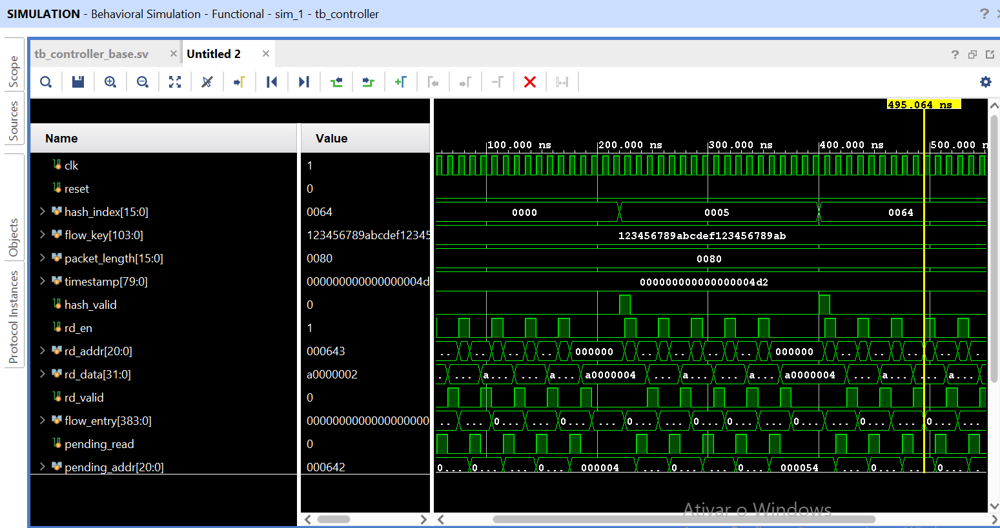
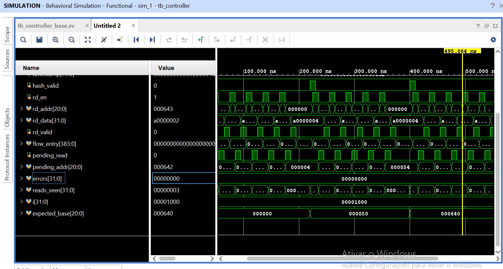

# Controller — Recepção de metadados e solicitação de LOOKUP

## 1. `controller.sv` — Módulo do Controller

### Objetivo

Implementa a etapa inicial do Controller, responsável por receber os metadados do pacote, iniciar a busca de uma entrada na Flow Table e armazenar as palavras retornadas pela memória.

Nesta etapa, o módulo:

- Recebe `hash_index`, acompanhado de `hash_valid`, proveniente da etapa de Extração de Metadados.
- Registra os metadados recebidos e gera internamente o sinal `start`.
- Calcula o endereço-base da entrada na Flow Table.
- Executa a FSM de LOOKUP, emitindo solicitações de leitura por meio de `rd_en` e `rd_addr`.
- Armazena as cinco palavras lidas em `flow_entry`.

A comparação de `flow_key`, a decisão de HIT/MISS/colisão, as operações de escrita e a interface com o Flow Finalizer não fazem parte desta etapa.

### 1.1. Organização da Flow Table

A organização lógica prevista para a Flow Table é:

- **65.536 entradas**.
- **16 palavras de 32 bits por entrada**.
- **512 bits por entrada**.
- **1.048.576 palavras de 32 bits no total**.

O endereço-base de uma entrada é calculado por:

```systemverilog
base_addr <= {1'b0, hash_index_reg, 4'b0000};
```

Essa operação equivale a:

\[
base\_addr = hash\_index \times 16
\]

O endereço de cada palavra solicitada é:

```systemverilog
rd_addr = base_addr + word_index;
```

Como cada entrada possui 16 palavras, o deslocamento de quatro bits calcula o endereço-base sem a necessidade de um multiplicador.

O sinal `base_addr` possui 21 bits, conforme a interface atual do Controller. Entretanto, os endereços válidos da organização descrita cabem em 20 bits, pois o maior endereço de palavra é 1.048.575. O bit mais significativo de `base_addr` permanece zero.

**Escopo atual:** o Controller solicita somente as palavras W0 a W4. As demais palavras da entrada não são lidas nesta etapa.

### 1.2. Elementos internos

| Elemento | Descrição |
|---|---|
| `state_t` | Tipo enumerado que define os estados da FSM. |
| `state` | Registrador que armazena o estado atual. |
| `hash_index_reg[15:0]` | Armazena o índice recebido para o LOOKUP. |
| `flow_key_reg[103:0]` | Armazena a chave do fluxo recebida. |
| `packet_length_reg[15:0]` | Armazena o comprimento do pacote. |
| `timestamp_reg[79:0]` | Armazena o timestamp recebido. |
| `start` | Sinal interno que solicita o início do LOOKUP. |
| `base_addr[20:0]` | Endereço-base calculado a partir de `hash_index_reg`. |
| `word_index[2:0]` | Índice da palavra solicitada, de 0 a 4. |

### 1.3. Interface do módulo

| Sinal | Direção | Largura | Descrição |
|---|---|---:|---|
| `clk` | Entrada | 1 bit | Clock; operações sequenciais ocorrem na borda de subida. |
| `reset` | Entrada | 1 bit | Reset síncrono, ativo em nível alto. |
| `hash_index` | Entrada | 16 bits | Índice da entrada a consultar na Flow Table. |
| `flow_key` | Entrada | 104 bits | Chave do fluxo, registrada, mas ainda não utilizada na busca. |
| `packet_length` | Entrada | 16 bits | Comprimento do pacote, registrado, mas ainda não utilizado. |
| `timestamp` | Entrada | 80 bits | Timestamp do pacote, registrado, mas ainda não utilizado. |
| `hash_valid` | Entrada | 1 bit | Indica que os metadados recebidos são válidos. |
| `rd_en` | Saída | 1 bit | Solicita uma leitura à Flow Table. |
| `rd_addr` | Saída | 21 bits | Endereço da palavra solicitada. |
| `rd_data` | Entrada | 32 bits | Palavra retornada pela memória. |
| `rd_valid` | Entrada | 1 bit | Indica que `rd_data` contém uma resposta válida. |
| `flow_entry` | Saída | 384 bits | Armazena os dados recebidos durante o LOOKUP. |

O sinal `start` é interno ao módulo e, portanto, não faz parte da interface externa.

### 1.4. Recepção dos metadados e sinal `start`

O primeiro bloco sequencial registra os metadados quando `hash_valid` está ativo:

```systemverilog
if (hash_valid) begin
    hash_index_reg   <= hash_index;
    flow_key_reg     <= flow_key;
    packet_length_reg <= packet_length;
    timestamp_reg   <= timestamp;
    start            <= 1'b1;
end else if (start) begin
    start <= 1'b0;
end
```

O funcionamento é o seguinte:

1. A etapa anterior apresenta os metadados e ativa `hash_valid`.
2. O Controller registra os valores recebidos.
3. O sinal interno `start` é ativado para indicar que existe uma solicitação de LOOKUP.
4. Quando `hash_valid` deixa de estar ativo, `start` é limpo na borda de clock seguinte, desde que não seja reativado por outro `hash_valid`.

Assim, a recepção dos metadados e a execução da FSM são etapas separadas. O sinal `hash_valid` captura os dados, enquanto `start` é utilizado para iniciar o processamento.

### 1.5. Funcionamento da FSM

O Controller utiliza quatro estados:

| Estado | Funcionamento | Próximo estado |
|---|---|---|
| `IDLE` | Aguarda `start`. Quando o sinal está ativo, calcula `base_addr`, zera `word_index` e limpa `flow_entry`. | `LOOKUP_REQ`, quando `start = 1`. |
| `LOOKUP_REQ` | Ativa `rd_en` e apresenta `base_addr + word_index` em `rd_addr`. | `LOOKUP_WAIT`. |
| `LOOKUP_WAIT` | Aguarda `rd_valid`. Quando recebe uma resposta válida, armazena `rd_data` na posição correspondente de `flow_entry`. | `LOOKUP_REQ` para as palavras seguintes ou `LOOKUP_DONE` após W4. |
| `LOOKUP_DONE` | Indica internamente que as cinco palavras foram recebidas. | `IDLE`. |

O bloco combinacional `always_comb` define os valores de `rd_en` e `rd_addr`. Os valores padrão são zero, evitando a inferência de latches. Somente em `LOOKUP_REQ` uma leitura é solicitada.

O bloco sequencial `always_ff` implementa a FSM, atualiza `base_addr` e armazena os dados recebidos. A FSM utiliza `rd_valid` para determinar quando uma resposta foi recebida, em vez de depender de um número fixo de ciclos de espera.

O reset é síncrono e ativo em nível alto.

### 1.6. Armazenamento das palavras

Cada palavra recebida é armazenada usando seleção variável de bits:

```systemverilog
flow_entry[word_index * 32 +: 32] <= rd_data;
```

O mapeamento utilizado é:

| Palavra | Bits de `flow_entry` |
|---|---|
| W0 | `[31:0]` |
| W1 | `[63:32]` |
| W2 | `[95:64]` |
| W3 | `[127:96]` |
| W4 | `[159:128]` |
| Não utilizados nesta etapa | `[383:160]` |

O sinal `flow_entry` possui 384 bits, conforme a interface atual. Portanto, somente os 160 bits inferiores são preenchidos pelas cinco leituras. Os bits `[383:160]` permanecem zerados porque o registro é limpo quando um novo LOOKUP é iniciado.

O avanço da FSM depende de `rd_valid`. Após receber uma palavra, o Controller incrementa `word_index` e solicita a próxima, até completar W4.

---

## 2. `tb_controller.sv` — Testbench

### Objetivo

O testbench verifica o comportamento da etapa de LOOKUP por meio de uma memória comportamental simplificada.

São verificados os seguintes requisitos:

- O endereço-base corresponde a `hash_index × 16`.
- O sinal `hash_valid` provoca o registro dos metadados e a ativação interna de `start`.
- Cada LOOKUP gera exatamente cinco solicitações de leitura.
- Os endereços solicitados são consecutivos e estão na ordem correta.
- As palavras retornadas são armazenadas nas posições esperadas de `flow_entry`.
- Os bits `[383:160]` permanecem zerados.

### 2.1. Configuração e conexão

O testbench declara os sinais de entrada e saída, instancia o Controller como `dut` e conecta as portas pelos nomes dos sinais.

A memória de teste é declarada como:

```systemverilog
logic [31:0] memory [0:4095];
```

Ela contém 4.096 palavras de 32 bits e é inicializada com zero no início da simulação.

Essa memória é apenas um modelo reduzido para os testes. Ela não representa a capacidade total prevista para a Flow Table.

### 2.2. Clock

O clock é gerado por:

```systemverilog
initial clk = 1'b0;
always #5 clk = ~clk;
```

O sinal é invertido a cada 5 ns, resultando em um período de 10 ns, equivalente a uma frequência de 100 MHz.

### 2.3. Modelo comportamental da memória

O modelo utiliza os sinais `pending_read` e `pending_addr` para representar uma solicitação pendente.

Quando `rd_en` é amostrado na borda de subida, o modelo registra o endereço solicitado. Em seguida, atualiza `rd_data` e `rd_valid` para indicar a resposta da memória.

Como os blocos sequenciais são executados na mesma borda de clock, o Controller consome a resposta na borda de subida seguinte àquela em que o modelo atualiza `rd_data` e `rd_valid`.

Esse comportamento permite verificar se a FSM aguarda corretamente a resposta antes de solicitar a próxima palavra.

### 2.4. Monitor de endereços

O monitor observa cada borda de subida em que `rd_en = 1`.

Para cada solicitação, compara o endereço emitido com:

```systemverilog
expected_base + reads_seen
```

Se houver divergência, o testbench registra um erro com `$error` e incrementa `errors`. O contador `reads_seen` é incrementado a cada solicitação observada.

Dessa forma, são verificados os endereços, a quantidade e a ordem das leituras.

### 2.5. Tarefa `run_lookup(test_hash)`

A tarefa executa um cenário de teste completo.

1. Aguarda o Controller retornar ao estado `IDLE`.
2. Calcula o endereço-base esperado a partir de `test_hash`.
3. Zera `reads_seen`.
4. Grava cinco valores de teste na memória, a partir do endereço-base.
5. Aplica `hash_index`, `flow_key`, `packet_length` e `timestamp`, ativando `hash_valid` por um ciclo.
6. Aguarda a ativação de `start` e, posteriormente, o estado `LOOKUP_DONE`.
7. Confere as cinco palavras armazenadas em `flow_entry`.
8. Verifica se os bits `[383:160]` permanecem zerados.
9. Confirma que foram emitidas exatamente cinco solicitações.

Os valores utilizados para as palavras são:

```systemverilog
memory[base + j] = 32'hA0000000 + j;
```

Assim, W0 contém `A0000000`, W1 contém `A0000001`, e sucessivamente até W4, que contém `A0000004`.

Como cada palavra tem um valor distinto, o teste detecta dados incorretos ou armazenados na posição errada.

Os metadados adicionais são mantidos constantes durante os três cenários:

- `flow_key = 0x123456789ABCDEF123456789AB`
- `packet_length = 128`
- `timestamp = 1234`

Esses valores verificam a conexão dos sinais, mas não sua utilização funcional, pois ainda não participam da lógica de lookup.

### 2.6. Sequência de testes

Após manter `reset = 1` por três bordas de descida, o testbench libera o reset e executa os seguintes cenários:

| Teste | `hash_index` | Base esperada | Endereços de leitura |
|---|---:|---:|---|
| 1 | 0 | 0 (`0x000`) | 0, 1, 2, 3, 4 |
| 2 | 5 | 80 (`0x050`) | 80, 81, 82, 83, 84 |
| 3 | 100 (`0x64`) | 1600 (`0x640`) | 1600, 1601, 1602, 1603, 1604 |

Os cenários cobrem o índice zero, um índice pequeno e um índice maior, verificando o cálculo do endereço-base e a sequência de endereços.

Ao final, o testbench imprime `TODOS OS TESTES PASSARAM!` quando `errors == 0`. Caso contrário, informa a quantidade de erros. Um timeout global de 100 µs encerra a simulação com `$fatal` se o teste não terminar.

---

## 3. Análise da forma de onda

### 3.1. Sinais relevantes

Durante a simulação, os sinais de maior interesse são:

- `hash_valid` e `hash_index`: identificam a entrada solicitada.
- `hash_index_reg`: mostra o índice registrado pelo Controller.
- `start`: indica a solicitação interna para iniciar o LOOKUP.
- `state`: mostra a evolução da FSM.
- `rd_en` e `rd_addr`: indicam as solicitações de leitura.
- `pending_read` e `pending_addr`: mostram a solicitação registrada pelo modelo de memória.
- `rd_valid` e `rd_data`: indicam a resposta da memória.
- `flow_entry`: mostra as palavras armazenadas pelo Controller.
- `reads_seen` e `errors`: auxiliam na verificação do testbench.

### 3.2. Sequência de um LOOKUP

Para o primeiro teste, com `hash_index = 0`, o endereço-base é zero.

A sequência funcional é:

1. O reset é liberado.
2. O testbench aplica os metadados e ativa `hash_valid`.
3. Na borda de subida, o Controller registra os metadados e ativa `start`.
4. Na borda seguinte, a FSM em `IDLE` identifica `start = 1`, calcula `base_addr` e avança para `LOOKUP_REQ`.
5. Em `LOOKUP_REQ`, `rd_en` é ativado e `rd_addr` apresenta o endereço da palavra solicitada.
6. A FSM avança para `LOOKUP_WAIT`.
7. O modelo de memória responde por meio de `rd_data` e `rd_valid`.
8. O Controller armazena a palavra e solicita a seguinte.
9. Após receber W4, a FSM entra em `LOOKUP_DONE`.
10. Na borda seguinte, retorna a `IDLE`.

O intervalo exato entre eventos depende do alinhamento dos sinais com as bordas de clock e do modelo de memória utilizado.

### 3.3. O que verificar na forma de onda





**Entrada do pacote:** `hash_valid` deve ser aceito enquanto o Controller está disponível para receber uma nova solicitação. Os valores de `hash_index` dos três testes são `0x0000`, `0x0005` e `0x0064`.

**Sinal de início:** após a captura dos metadados, `start` deve ser ativado. A FSM inicia o LOOKUP quando identifica esse sinal em `IDLE`.

**Solicitações de leitura:** cada LOOKUP deve gerar cinco pulsos de `rd_en`, um para cada palavra W0–W4.

**Endereços:** `rd_addr` deve percorrer cinco endereços consecutivos a partir da base calculada. Para os três testes, as sequências terminam nos endereços 4, 84 e 1604, respectivamente.

**Respostas da memória:** `rd_valid` deve indicar cada resposta, e `rd_data` deve conter os valores de teste correspondentes.

**Armazenamento:** `flow_entry[31:0]` recebe W0, `flow_entry[63:32]` recebe W1, e assim sucessivamente até W4 em `flow_entry[159:128]`.

**Verificação:** `reads_seen` deve chegar a 5 em cada cenário, e `errors` deve permanecer em zero se todas as verificações forem aprovadas.

---

## 4. Critérios de verificação

| Requisito | Evidência esperada |
|---|---|
| Instanciar o Controller | Portas conectadas corretamente entre `tb_controller` e `dut`. |
| Receber metadados válidos | `hash_valid` provoca o registro dos metadados. |
| Gerar o sinal de início | `start` é ativado após a captura dos metadados. |
| Iniciar a FSM | O Controller sai de `IDLE` quando identifica `start = 1`. |
| Calcular o endereço-base | `base_addr = hash_index × 16`. |
| Gerar os endereços de leitura | Cinco endereços consecutivos, de `base_addr` até `base_addr + 4`. |
| Respeitar a resposta da memória | A FSM aguarda `rd_valid` antes de avançar para a próxima palavra. |
| Emitir cinco solicitações | `reads_seen == 5` em cada teste. |
| Armazenar as palavras corretamente | W0–W4 coincidem com `A0000000` a `A0000004`. |
| Manter os bits restantes zerados | `flow_entry[383:160] == 0`. |
| Finalizar a verificação | `errors == 0` e mensagem de aprovação no console. |

A aprovação desses critérios valida o comportamento da etapa de lookup nos cenários testados. Ela não comprova o funcionamento das etapas de comparação de chave, atualização de fluxo ou escrita na memória.

---

## 5. Limitações e próximos passos

A implementação atual é uma primeira etapa funcional do Controller, limitada à recepção dos metadados, ao início do LOOKUP e ao armazenamento de cinco palavras.

As principais limitações são:

- **Metadados:** `flow_key`, `packet_length` e `timestamp` são registrados, mas ainda não são utilizados na lógica de lookup.
- **Handshake:** não existe um sinal `in_ready`. O Controller não possui um mecanismo explícito para sinalizar disponibilidade ou aceitar solicitações em sequência. O testbench evita esse caso aguardando o retorno a `IDLE`.
- **Solicitações durante processamento:** o RTL atual não implementa uma fila de entrada. Se `hash_valid` for apresentado enquanto a FSM estiver ocupada, os registradores de metadados podem ser atualizados mesmo que a FSM não inicie imediatamente outro LOOKUP. O testbench não cobre esse cenário.
- **Leitura parcial:** somente W0–W4 são lidas. As palavras restantes da entrada não são carregadas em `flow_entry`.
- **Largura de endereço:** `rd_addr` possui 21 bits, enquanto os endereços válidos da memória prevista cabem em 20 bits. A largura deverá ser alinhada durante a integração com a Flow Table.
- **Modelo de memória:** o testbench utiliza uma memória comportamental de 4096 palavras, suficiente para os cenários escolhidos, mas menor que a capacidade prevista para a Flow Table.
- **Tratamento de fluxos:** ainda não há comparação de `flow_key`, classificação HIT/MISS/COLLISION ou tratamento de colisões.
- **Escrita:** os sinais `wr_en`, `wr_addr`, `wr_data` e `wr_done` não fazem parte da interface implementada nesta etapa.
- **Finalização:** a interface com o Flow Finalizer ainda não está implementada.

