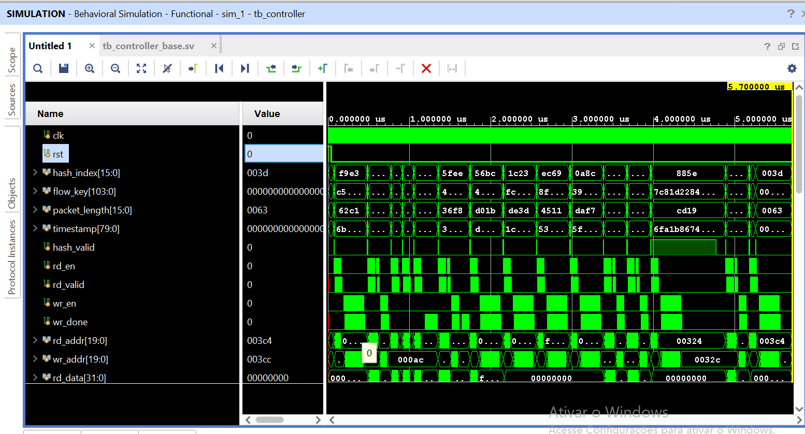
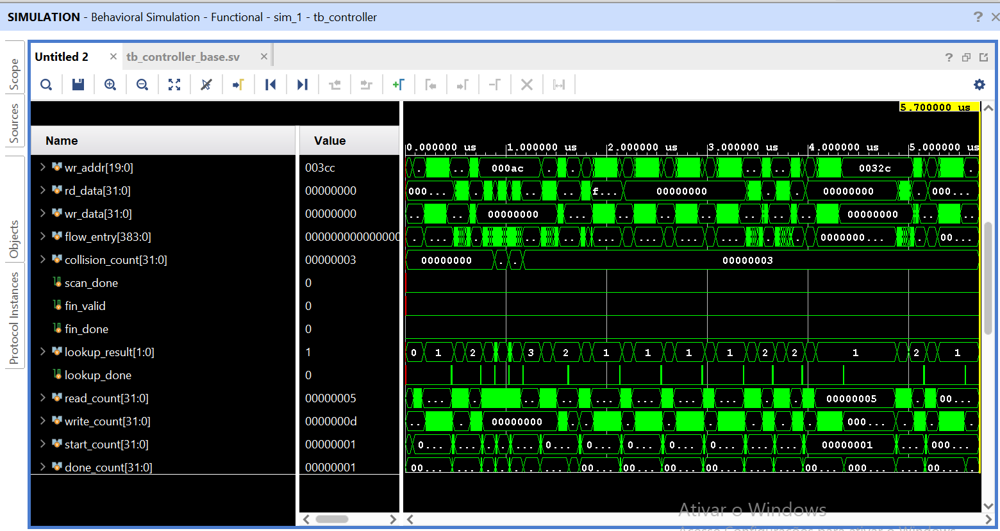
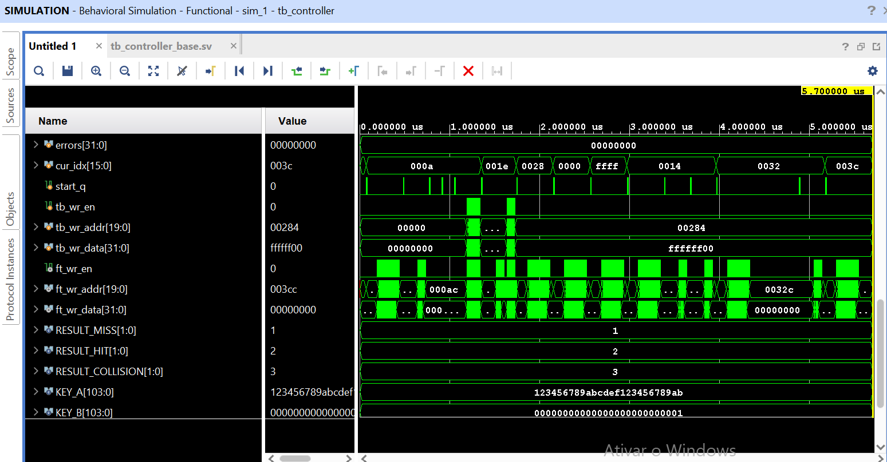
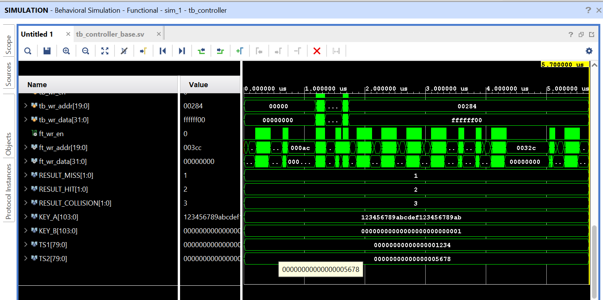

# Controller — Recepção, Lookup e Classificação (MISS / HIT / COLLISION)

## 1. `controller.sv` — Módulo do Controller

### Objetivo

Nesta etapa, o Controller:

- Recebe os metadados do pacote (`hash_valid` + dados), captura-os e gera o sinal interno `start`.
- Consulta a Flow Table lendo `valid` e `flow_key` (palavras W0–W4).
- Classifica o resultado em **MISS**, **HIT** ou **COLLISION**.
- Executa a operação correspondente: cria o fluxo (MISS), atualiza os contadores (HIT) ou preserva a entrada (COLLISION).

A varredura de finalização e a interface com o Flow Finalizer não fazem parte desta etapa (`fin_valid = 0`).

### 1.1. Interface do módulo

| Sinal | Direção | Largura | Descrição |
|---|---|---:|---|
| `clk` | Entrada | 1 bit | Clock do sistema. |
| `rst` | Entrada | 1 bit | Reset assíncrono, ativo em nível alto. |
| `hash_index` | Entrada | 16 bits | Índice da entrada na Flow Table. |
| `flow_key` | Entrada | 104 bits | Chave do fluxo. |
| `packet_length` | Entrada | 16 bits | Tamanho do pacote em bytes. |
| `timestamp` | Entrada | 80 bits | Timestamp do pacote. |
| `hash_valid` | Entrada | 1 bit | Indica que os metadados são válidos. |
| `rd_en` / `rd_addr` | Saída | 1 / 20 bits | Pedido de leitura à Flow Table. |
| `rd_data` / `rd_valid` | Entrada | 32 / 1 bit | Palavra lida e sua validade. |
| `wr_en` / `wr_addr` / `wr_data` | Saída | 1 / 20 / 32 bits | Pedido de escrita à Flow Table. |
| `wr_done` | Entrada | 1 bit | Conclusão da escrita. |
| `flow_entry` | Saída | 416 bits | Registro W0–W12 montado pelo Controller. |
| `fin_valid` / `fin_done` | Saída / Entrada | 1 / 1 bit | Reservados para o Flow Finalizer (não usados). |
| `lookup_result` | Saída | 2 bits | `01` MISS, `10` HIT, `11` COLLISION, `00` nenhum. |
| `lookup_done` | Saída | 1 bit | Pulso de 1 ciclo ao final da operação. |

### 1.2. Recepção do barramento

O protocolo entre módulos usa **somente `valid`, sem `ready`**. Quando `hash_valid = 1`, o Controller captura os dados e pulsa `start` por 1 ciclo. Esse bloco é separado da FSM e segue o padrão acordado:

```systemverilog
always_ff @(posedge clk or posedge rst) begin
    if (rst) begin
        hash_index_reg    <= '0;
        flow_key_reg      <= '0;
        packet_length_reg <= '0;
        timestamp_reg     <= '0;
        start             <= 1'b0;
    end else begin
        if (hash_valid) begin
            hash_index_reg    <= hash_index;
            flow_key_reg      <= flow_key;
            packet_length_reg <= packet_length;
            timestamp_reg     <= timestamp;
            start             <= 1'b1;
        end else if (start) begin
            start <= 1'b0;
        end
    end
end
```

**Premissa de integração:** como não há `ready`, o Data Mover não deve enviar um novo `hash_valid` enquanto o Controller estiver ocupado. Em simulação, um `$error` é emitido se isso ocorrer.

### 1.3. Endereçamento

Cada entrada tem 16 palavras de 32 bits. O endereço de 20 bits é formado por:

```systemverilog
rd_addr = {hash_index_reg, word_index};   // base_addr = hash_index << 4
```

Exemplo: `hash_index = 5` → entrada nos endereços 80 a 95.

### 1.4. FSM

| Estado | Função | Próximo estado |
|---|---|---|
| `IDLE` | Aguarda `start`; calcula `base_addr` e limpa `flow_entry`. | `LOOKUP_REQ` |
| `LOOKUP_REQ` | Ativa `rd_en` com o endereço da palavra. | `LOOKUP_WAIT` |
| `LOOKUP_WAIT` | Aguarda `rd_valid`; guarda `valid` e `flow_key`. | `LOOKUP_REQ` (até W4) ou `CLASSIFY` |
| `CLASSIFY` | Decide MISS, HIT ou COLLISION. | `PREPARE_WRITE`, `HIT_READ_REQ` ou `IDLE` |
| `HIT_READ_REQ` / `HIT_READ_WAIT` | Lê W5 (`packet_count`) e W6 (`byte_count`). | `PREPARE_WRITE` |
| `PREPARE_WRITE` | Calcula os novos valores e define a primeira palavra a escrever. | `WRITE_REQ` |
| `WRITE_REQ` / `WRITE_WAIT` | Escreve uma palavra e aguarda `wr_done`. | `WRITE_REQ` ou `IDLE` (após W12) |

Correspondência com a especificação: FETCH = `LOOKUP_*`, CHECK = `CLASSIFY`, INSERT = escritas de MISS, UPDATE = leituras e escritas de HIT.

A FSM aguarda `rd_valid` e `wr_done` em vez de contar ciclos.

### 1.5. Lookup e classificação

O lookup lê W0–W4 (5 leituras, sem escrita):

| Palavra | Campo usado |
|---|---|
| W0 | `valid` (somente o bit 0) |
| W1 | `flow_key[31:0]` |
| W2 | `flow_key[63:32]` |
| W3 | `flow_key[95:64]` |
| W4 | `flow_key[103:96]` (somente os bits [7:0]; o restante é reservado e ignorado) |

Classificação no estado `CLASSIFY`:

| Condição | Resultado | Ação |
|---|---|---|
| `valid = 0` | **MISS** | Cria o fluxo: escreve W0–W12. |
| `valid = 1` e chave armazenada = chave nova (104 bits) | **HIT** | Lê W5–W6; escreve W5, W6, W10, W11, W12. |
| `valid = 1` e chave armazenada ≠ chave nova | **COLLISION** | Nenhuma escrita; entrada preservada. |

### 1.6. Operações de memória

| Resultado | Leituras | Escritas | Total |
|---|---:|---:|---:|
| MISS | 5 | 13 | 18 |
| HIT | 7 | 5 | 12 |
| COLLISION | 5 | 0 | 5 |

---

## 2. `tb_controller.sv` — Testbench

### Objetivo

Verificar a recepção, o lookup e a classificação com o Controller conectado à **Flow Table real** (`flow_table.sv`).

### 2.1. Configuração

- A Flow Table é instanciada com latência de 1 ciclo para leitura e escrita, conforme o contrato de interface.
- A memória é inicializada em zero na declaração (todos os `valid` começam em 0).
- Os casos que precisam de conteúdo prévio são pré-carregados pela porta de escrita da Flow Table, por meio de um mux no testbench.
- Logo após `hash_valid`, as entradas são embaralhadas, para provar que o Controller capturou os dados no ciclo correto.
- Clock de 100 MHz (período de 10 ns).

### 2.2. Verificações automáticas

- `start` dura exatamente 1 ciclo.
- Todo endereço de leitura e escrita pertence à entrada consultada (`addr[19:4] = hash_index`).
- Nenhuma leitura retorna valor desconhecido (`X`), o que detectaria memória não inicializada.
- Cada cenário confere `lookup_result`, o número de leituras, o número de escritas e o conteúdo final da memória.

### 2.3. Cenários e resultados

| # | Cenário | Resultado esperado | Leituras / escritas | Obtido |
|---|---|---|---:|---|
| 1 | Entrada vazia (`hash_index` = 10) | MISS | 5 / 13 | PASSOU |
| 2 | Mesma chave | HIT (contador = 2, bytes = 150) | 7 / 5 | PASSOU |
| 3 | Chave totalmente diferente | COLLISION, entrada intacta | 5 / 0 | PASSOU |
| 4 | Chave difere só no bit 0 | COLLISION | 5 / 0 | PASSOU |
| 5 | Chave difere só no bit 103 (W4[7]) | COLLISION | 5 / 0 | PASSOU |
| 6 | HIT com lixo em W0[31:1] e W4[31:8] | HIT; W0 e `first_timestamp` preservados | 7 / 5 | PASSOU |
| 7 | W0 = `FFFFFFFE` (`valid` = 0) | MISS | 5 / 13 | PASSOU |
| 8 | `hash_index` = 0 e 65535 | MISS | 5 / 13 | PASSOU |
| 9 | MISS + HIT + HIT em sequência | `packet_count` = 3, bytes = 30 | 5/13, 7/5, 7/5 | PASSOU |

Resultado final: `TODOS OS TESTES PASSARAM!`, com `$finish` em 3980 ns e `errors = 0`.

---

## 3. Análise da forma de onda



**Entrada e acessos à memória:** cada pulso de `hash_valid` é seguido por leituras (`rd_en`, `rd_valid`) e, nos casos de MISS e HIT, por escritas (`wr_en`, `wr_done`). Os endereços acompanham o `hash_index` de cada pacote.



**Classificação:** `lookup_result` assume 1 (MISS), 2 (HIT) e 3 (COLLISION), com um pulso de `lookup_done` ao final de cada operação. `read_count` e `write_count` acompanham as operações e `errors` permanece em zero. `cur_idx` mostra a entrada acessada em cada cenário.



**Apoio do testbench:** pré-carga da memória pela porta `tb_wr_*`, pulso de `start` de 1 ciclo (`start_q`) e as constantes dos cenários (`KEY_A`, `KEY_B`, `TS1`, `TS2`).



**Console:** todos os cenários com `PASSOU` e a mensagem final de aprovação.

---

## 4. Critérios de verificação

| Requisito | Evidência | Status |
|---|---|---|
| Receber metadados válidos | `hash_valid` provoca a captura dos dados | Aprovado |
| Gerar `start` | Pulso de 1 ciclo após `hash_valid` | Aprovado |
| Lookup conectado à Flow Table | Leitura de W0–W4 com `rd_en` / `rd_valid` | Aprovado |
| Comparar 104 bits da chave | Cenários 4, 5 e 6 | Aprovado |
| Usar só o bit 0 de `valid` | Cenários 6 e 7 | Aprovado |
| Classificar MISS | Cenários 1, 7, 8 e 9 | Aprovado |
| Classificar HIT | Cenários 2, 6 e 9 | Aprovado |
| Classificar COLLISION | Cenários 3, 4 e 5 (nenhuma escrita) | Aprovado |
| Endereços dentro da entrada | Monitor de endereços, incluindo `hash_index` 0 e 65535 | Aprovado |
| Operações consecutivas | Cenário 9 | Aprovado |

---

## 5. Limitações e próximos passos

- **Sem `ready`:** o Controller não sinaliza disponibilidade. A garantia de que não chega um novo `hash_valid` enquanto ele está ocupado é do Data Mover e precisa ser mantida na integração.
- **Finalização:** a varredura e o envio ao Flow Finalizer ainda não foram implementados.
- **`flow_entry` com 416 bits:** necessário para carregar W0–W12, mas a figura da arquitetura mostra 384 bits. Alinhar com o Flow Finalizer.
- **`flow_entry` no HIT:** as palavras W7–W9 (`first_timestamp`) não são lidas no HIT, então não estão no `flow_entry` nesse caso. Se o Finalizer precisar desse campo, será necessário lê-lo ou ler a entrada na própria varredura.
- **Largura do endereço:** o Controller usa 20 bits, conforme o contrato da Flow Table. A figura mostra 21 bits e precisa ser atualizada.
- **Nome do reset:** o Controller usa `rst` (assíncrono, como no padrão acordado); a figura usa `reset`. Padronizar.
- **Latência da memória:** os testes usaram `rd_valid` com 1 ciclo. O Controller espera `rd_valid`, então deve tolerar latências maiores, mas isso ainda não foi simulado.
