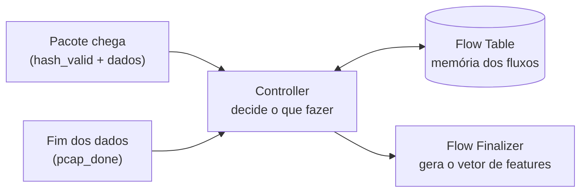
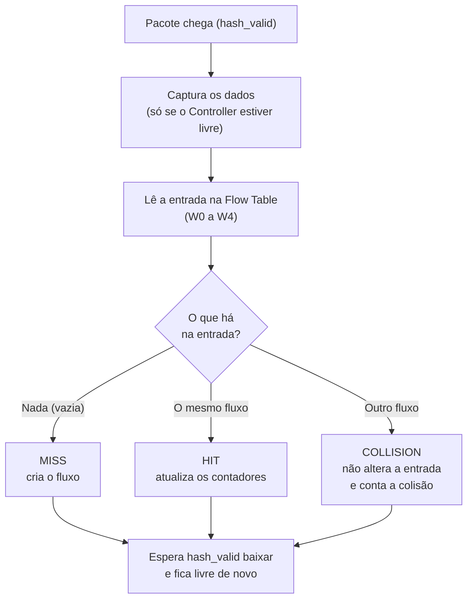
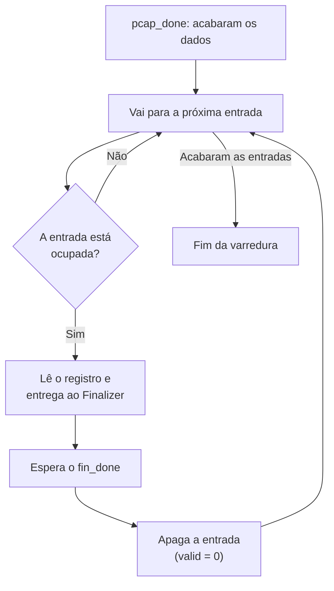
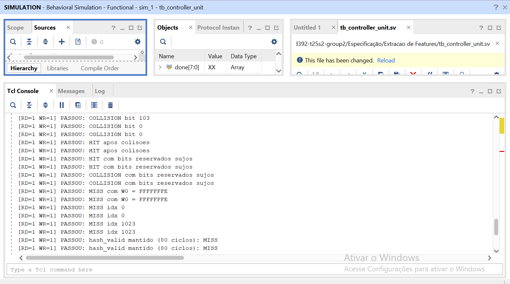
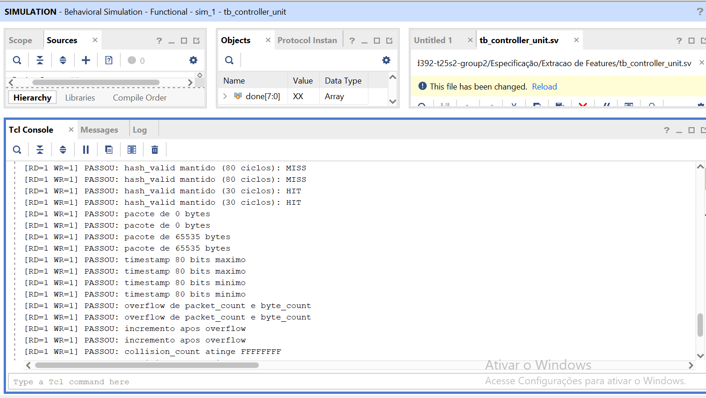
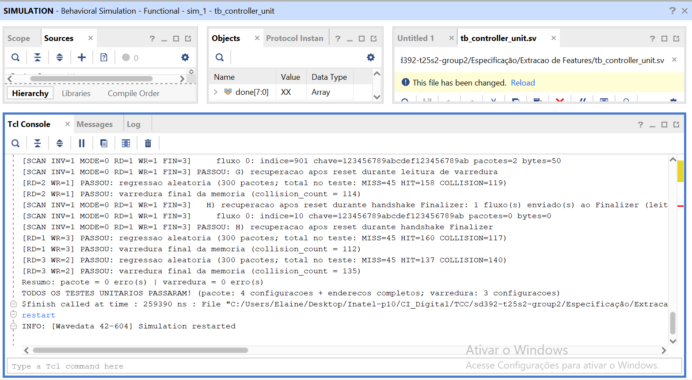
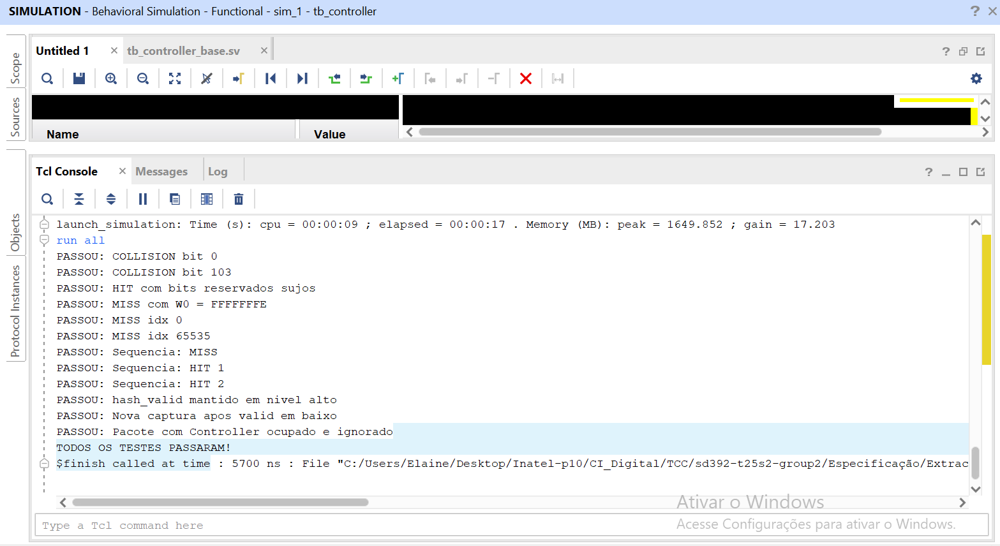

# Controller — Recepção, Lookup, Classificação (MISS / HIT / COLLISION) e Varredura

## 1. `controller.sv` — Módulo do Controller

### Objetivo

O Controller coordena o processamento de cada pacote:

- Recebe os metadados do pacote pelo protocolo `valid` (sem `ready`), captura os dados e sinaliza `start` para iniciar a FSM.
- Consulta a Flow Table lendo `valid` e `flow_key` (palavras W0–W4).
- Classifica o resultado em **MISS**, **HIT** ou **COLLISION**.
- Executa a operação correspondente: cria o fluxo (MISS), atualiza os contadores (HIT) ou preserva a entrada e conta a falha (COLLISION).
- Quando os dados acabam (`pcap_done`), varre a Flow Table e entrega cada fluxo válido ao Flow Finalizer.



**O que acontece com um pacote:**

1. `hash_valid` chega. Em `IDLE`, o Controller **captura** os dados e inicia a FSM (`start`).
2. Calcula o endereço da entrada (`hash_index × 16`).
3. **Lê** W0 a W4 (o bit `valid` e a `flow_key` armazenada).
4. **Classifica** comparando com o pacote recebido: MISS, HIT ou COLLISION.
5. Executa a ação do caso (criar, atualizar ou preservar a entrada).
6. Espera `hash_valid` voltar a zero e retorna a `IDLE`, pronto para o próximo pacote.

### 1.1. Interface do módulo

A interface é **exatamente a da figura da arquitetura**. Não existem outras portas.

| Sinal | Direção | Largura | Descrição |
|---|---|---:|---|
| `clk` | Entrada | 1 bit | Clock do sistema. |
| `rst` | Entrada | 1 bit | Reset **síncrono**, ativo em nível alto. |
| `hash_index` | Entrada | 16 bits | Índice da entrada do fluxo na Flow Table. |
| `flow_key` | Entrada | 104 bits | Chave que identifica o fluxo. |
| `packet_length` | Entrada | 16 bits | Tamanho do pacote em bytes. |
| `timestamp` | Entrada | 80 bits | Timestamp do pacote. |
| `hash_valid` | Entrada | 1 bit | Indica que os metadados acima são válidos. |
| `rd_en` | Saída | 1 bit | Pede uma leitura à Flow Table (pulso de 1 ciclo). |
| `rd_addr` | Saída | 20 bits | Endereço da palavra a ler. |
| `rd_data` | Entrada | 32 bits | Palavra lida. |
| `rd_valid` | Entrada | 1 bit | `rd_data` é válido (1 ciclo depois do `rd_en`). |
| `wr_en` | Saída | 1 bit | Pede uma escrita (pulso de 1 ciclo). |
| `wr_addr` | Saída | 20 bits | Endereço da palavra a escrever. |
| `wr_data` | Saída | 32 bits | Palavra a escrever. |
| `wr_done` | Entrada | 1 bit | A escrita foi concluída (1 ciclo depois do `wr_en`). |
| `flow_entry` | Saída | 384 bits | Registro W1–W12 do fluxo, enviado ao Finalizer. |
| `fin_valid` | Saída | 1 bit | Há um fluxo em `flow_entry` para o Finalizer. |
| `fin_done` | Entrada | 1 bit | O Finalizer terminou o fluxo (pulso de 1 ciclo; funciona como `ready`). |
| `pcap_done` | Entrada | 1 bit | Fim dos dados; dispara a varredura (pulso). |

**Parâmetros do módulo**

| Parâmetro | Padrão | Função |
|---|---|---|
| `INVALIDATE_AFTER_SEND` | 1 | Depois de enviar um fluxo ao Finalizer, escreve `valid = 0` em W0. |
| `SCAN_ENTRIES` | 65536 | Número de entradas percorridas na varredura (os testes usam 1024). |

**Sinais internos** (não fazem parte da interface; os testbenches os observam por referência hierárquica, por exemplo `dut.lookup_result`):

| Sinal | Descrição |
|---|---|
| `lookup_result[1:0]` | Resultado do último pacote: `01` MISS, `10` HIT, `11` COLLISION, `00` nenhum. Fica estável até o próximo pacote. |
| `lookup_done` | Pulso de 1 ciclo ao fim de cada operação de pacote. |
| `collision_count[31:0]` | Quantidade de colisões. Satura em `FFFFFFFF` (não dá a volta) e zera no reset. Marcado com `(* keep = "true" *)`: sem nenhuma saída que o use, a síntese o removeria como lógica sem uso. |
| `scan_done` | Pulso de 1 ciclo ao fim da varredura. |
| `start` | Pulso de 1 ciclo quando o Controller aceita um pacote (`IDLE` e `hash_valid`). |
| `state` | Estado atual da FSM. |

### 1.2. Organização da Flow Table e endereçamento

A Flow Table guarda **65.536 entradas** (uma por valor de `hash_index`), cada uma com **16 palavras de 32 bits** (512 bits), num total de 1.048.576 palavras endereçadas com 20 bits. O Controller calcula o endereço de cada palavra:

```systemverilog
rd_addr = {entry_idx, word_index};   // entry_idx = hash_index (pacote) ou índice da varredura
                                     // equivale a (hash_index × 16) + word_offset
```

Exemplo: `hash_index = 5` → a entrada ocupa os endereços 80 a 95. Multiplicar por 16 é só um deslocamento de 4 bits, sem multiplicador.

**Conteúdo de uma entrada** (só W0–W12 são usados; W13–W15 são reservados):

| Palavra | Campo | Observação |
|---|---|---|
| W0 | `valid` | Só o bit 0 vale; os outros bits são reservados. |
| W1–W4 | `flow_key` (104 bits) | W4 usa só os bits [7:0]; os demais são reservados. |
| W5 | `packet_count` | Quantidade de pacotes do fluxo. |
| W6 | `byte_count` | Soma dos bytes do fluxo. |
| W7–W9 | `first_timestamp` (80 bits) | Timestamp do primeiro pacote. |
| W10–W12 | `last_timestamp` (80 bits) | Timestamp do último pacote. |

**Contrato da Flow Table:** a leitura devolve `rd_valid` e `rd_data` no ciclo seguinte ao `rd_en`, e a escrita devolve `wr_done` no ciclo seguinte ao `wr_en`. O Controller **espera esses sinais**, em vez de contar ciclos, e por isso funciona também com memórias mais lentas (testado com latências de até 3 ciclos).

### 1.3. `flow_entry` (384 bits)

O que o Controller entrega ao Finalizer é o registro **W1 a W12**, sem o W0. Por isso o barramento tem 384 bits (12 palavras × 32), e o W1 fica nos bits [31:0].

| Palavra | Bits de `flow_entry` | Campo |
|---|---|---|
| W1–W4 | `[127:0]` | `flow_key` |
| W5 | `[159:128]` | `packet_count` |
| W6 | `[191:160]` | `byte_count` |
| W7–W9 | `[287:192]` | `first_timestamp` |
| W10–W12 | `[383:288]` | `last_timestamp` |

### 1.4. Recepção do barramento

O protocolo entre módulos usa **somente `valid`, sem `ready`**: quem envia ativa `valid` junto com os dados, e quem recebe captura quando `valid` está ativo. Uma nova leitura do barramento só é aceita depois que `valid` volta a zero. O Controller segue o padrão do exemplo emissor/receptor (captura por nível):

- A captura só acontece no estado `IDLE`, quando `hash_valid = 1`.
- Depois da operação, o Controller aguarda `hash_valid` voltar a 0 (estado `WAIT_VALID_LOW`) antes de aceitar uma nova leitura.

O sinal `start` é um pulso de 1 ciclo, gerado apenas em `IDLE`:

```systemverilog
wire start = (state == IDLE) && hash_valid;

always_ff @(posedge clk) begin
    if (rst) begin
        base_addr         <= '0;
        flow_key_reg      <= '0;
        packet_length_reg <= '0;
        timestamp_reg     <= '0;
    end else if (start) begin
        base_addr         <= {hash_index, 4'b0000};   // hash_index x 16
        flow_key_reg      <= flow_key;
        packet_length_reg <= packet_length;
        timestamp_reg     <= timestamp;
    end
end
```

**Por que assim**

- **`start` só existe em `IDLE`.** Um `hash_valid` que chega com o Controller ocupado nunca é capturado, o que impede que um pacote novo sobrescreva os registradores no meio de uma operação.
- **Captura em um único ciclo.** Se o produtor mudar os dados depois do primeiro ciclo, o Controller não é afetado.
- **`WAIT_VALID_LOW`.** Um `hash_valid` mantido em nível alto por vários ciclos gera **uma única** operação, e não várias.

**Consequências para a integração**

- Um pacote que chega com o Controller ocupado é **perdido**: não há `ready` nem FIFO. A equipe confirmou que o sistema trabalha com folga, então o Data Mover não deve gerar essa situação.
- O reset é **síncrono**.

### 1.5. FSM

**Caminho de um pacote:**



A tabela abaixo detalha cada estado da FSM, para quem for ler o código (são 19 estados, 9 do pacote e 10 da varredura).

| Estado | Função | Próximo estado |
|---|---|---|
| `IDLE` | Aguarda `start` (captura os dados) ou um pedido de varredura. O pacote tem prioridade sobre a varredura. | `LOOKUP_REQ` ou `SCAN_V_REQ` |
| `LOOKUP_REQ` / `LOOKUP_WAIT` | Pede a leitura de uma palavra (`rd_en` por 1 ciclo) e espera `rd_valid`; repete de W0 a W4. | `CLASSIFY` |
| `CLASSIFY` | Decide MISS, HIT ou COLLISION. | `PREPARE_WRITE`, `HIT_READ_REQ` ou `WAIT_VALID_LOW` |
| `HIT_READ_REQ` / `HIT_READ_WAIT` | Lê W5 (`packet_count`) e W6 (`byte_count`). | `PREPARE_WRITE` |
| `PREPARE_WRITE` | Calcula os novos valores e define a primeira palavra a escrever. | `WRITE_REQ` |
| `WRITE_REQ` / `WRITE_WAIT` | Pede a escrita de uma palavra (`wr_en` por 1 ciclo) e espera `wr_done`. | `WRITE_REQ` ou `WAIT_VALID_LOW` (após W12) |
| `WAIT_VALID_LOW` | Aguarda `hash_valid = 0`. O pulso de `lookup_done` sai ao entrar neste estado. | `IDLE` |
| `SCAN_*` | Estados da varredura (seção 1.9). | |

Correspondência com a especificação funcional: FETCH = `LOOKUP_*`, CHECK = `CLASSIFY`, INSERT = escritas do MISS, UPDATE = leituras e escritas do HIT. A FSM aguarda `rd_valid`, `wr_done` e `fin_done` em vez de contar ciclos.

### 1.6. Lookup e classificação

O lookup lê W0 a W4 (**5 leituras, nenhuma escrita**) e guarda o `valid` e a `flow_key` armazenada.

| Palavra | Campo usado |
|---|---|
| W0 | `valid` (somente o bit 0) |
| W1 | `flow_key[31:0]` |
| W2 | `flow_key[63:32]` |
| W3 | `flow_key[95:64]` |
| W4 | `flow_key[103:96]` (somente os bits [7:0]; o restante é reservado e ignorado) |

Os bits reservados podem conter lixo, por isso o `valid` usa só o bit 0 e a chave usa exatamente 104 bits.

Classificação no estado `CLASSIFY`:

| Condição | Resultado | Significado |
|---|---|---|
| `valid = 0` | **MISS** | O fluxo ainda não existe. |
| `valid = 1` e chave armazenada = chave do pacote (104 bits) | **HIT** | O fluxo já existe. |
| `valid = 1` e chave armazenada ≠ chave do pacote | **COLLISION** | Outro fluxo ocupa a mesma entrada. |

### 1.7. Tratamento de MISS, HIT e COLLISION

**MISS: criar o fluxo.** A entrada está livre. O Controller escreve o registro novo em **13 escritas** (W0 a W12):

| Palavra | Valor escrito |
|---|---|
| W0 | `1` (`valid`) |
| W1–W4 | `flow_key` do pacote (W4 com os bits [7:0]) |
| W5 | `1` (`packet_count`) |
| W6 | `packet_length` (`byte_count`) |
| W7–W9 | `timestamp` (`first_timestamp`) |
| W10–W12 | `timestamp` (`last_timestamp`) |

**HIT: atualizar o fluxo.** O Controller lê W5 e W6 (mais **2 leituras**) e escreve **5 palavras**:

| Palavra | Valor escrito |
|---|---|
| W5 | `packet_count + 1` |
| W6 | `byte_count + packet_length` |
| W10–W12 | `timestamp` do pacote atual (`last_timestamp`) |

W0–W4 já estão corretos e **W7–W9** (`first_timestamp`) não são lidos nem escritos, porque o Controller não os usa na atualização.

**COLLISION: preservar e contar.** Outra chave ocupa a entrada. O Controller **não escreve nada**: a entrada existente fica preservada e o pacote novo é descartado. A falha é sinalizada **incrementando `collision_count`**, que satura em `FFFFFFFF`.

| Resultado | Leituras | Escritas | `collision_count` | Total de operações |
|---|---:|---:|---|---:|
| MISS | 5 | 13 | não muda | 18 |
| HIT | 7 | 5 | não muda | 12 |
| COLLISION | 5 | 0 | + 1 | 5 |

**Conteúdo de `flow_entry` ao fim de cada caso:**

| Caso | W1–W4 | W5–W6 | W7–W9 | W10–W12 |
|---|---|---|---|---|
| MISS | chave do pacote | 1 e `packet_length` | `timestamp` | `timestamp` |
| HIT | chave armazenada | valores atualizados | zero (não são lidos) | `timestamp` do pacote |
| COLLISION | chave armazenada | zero | zero | zero |

### 1.8. Estouro dos contadores

`packet_count` e `byte_count` têm 32 bits e **dão a volta** (módulo 2³²) se estourarem. Esse é o comportamento atual e está registrado nos testes, mas não é um requisito confirmado pela equipe. O `collision_count`, ao contrário, **satura** em `FFFFFFFF`.

### 1.9. Varredura e finalização

Quando os dados acabam, o Controller percorre a Flow Table e entrega cada fluxo ao Flow Finalizer.



1. **Disparo.** `pcap_done` (pulso do testbench) cria um pedido de varredura, detectado na **borda de subida**: funciona com pulso e também com nível alto. Se o Controller estiver ocupado com um pacote, o pedido é **memorizado** e a varredura começa quando ele voltar a `IDLE`.
2. **Varredura.** Para cada entrada de 0 até `SCAN_ENTRIES - 1`, lê W0. Se `valid = 0`, passa para a próxima. Se `valid = 1`, lê W1 a W12 para o `flow_entry`.
3. **Envio ao Finalizer.** Mantém `fin_valid = 1` até o Finalizer responder `fin_done` (pulso de 1 ciclo). O `fin_done` funciona como `ready`: quando o Finalizer termina de gerar o vetor, o Controller fornece o próximo fluxo. O `flow_entry` fica estável durante todo o `fin_valid`.
4. **Invalidação.** Depois do `fin_done`, o Controller espera `fin_done` voltar a zero e escreve `W0 = 0`, **invalidando a entrada** (se `INVALIDATE_AFTER_SEND = 1`). Assim, uma segunda varredura não reenvia os mesmos fluxos.
5. **Fim.** Na última entrada, o sinal interno `scan_done` pulsa por 1 ciclo e o Controller volta a `IDLE`.

Pacotes que chegam durante a varredura são ignorados (mesma regra de pacote com Controller ocupado). Esse comportamento é adequado ao fluxo de teste com arquivo, em que os pacotes já acabaram quando `pcap_done` chega; para a operação contínua ver a seção 7. Uma varredura completa faz `SCAN_ENTRIES` leituras de W0, mais 12 leituras por fluxo válido e 1 escrita por fluxo invalidado.

---

## 2. `tb_controller.sv` — Testbench de integração

### Objetivo

Verificar a recepção, o lookup, a classificação e o tratamento de MISS, HIT e COLLISION com o Controller conectado à **Flow Table real** (`flow_table.sv`).

### 2.1. Configuração

- A Flow Table é instanciada com latência de 1 ciclo para leitura e escrita, conforme o contrato de interface.
- A memória é inicializada em zero na declaração (todos os `valid` começam em 0), o que evita valores desconhecidos (`X`) na primeira leitura de cada entrada.
- Os casos que precisam de conteúdo prévio são pré-carregados pela porta de escrita da Flow Table, por meio de um mux no testbench (`tb_wr_*`).
- Logo após `hash_valid`, as entradas são embaralhadas, para provar que o Controller capturou os dados no ciclo correto.
- Clock de 100 MHz (período de 10 ns).

### 2.2. Verificações automáticas

- `start` dura exatamente 1 ciclo, e cada operação gera exatamente 1 pulso de `start` e 1 de `lookup_done`.
- Todo endereço de leitura e escrita pertence à entrada consultada (`addr[19:4] = hash_index`).
- Nenhuma leitura retorna valor desconhecido (`X`).
- Cada cenário confere `lookup_result`, o número de leituras, o número de escritas, o `collision_count` e o conteúdo final da memória.

### 2.3. Cenários e resultados

| # | Cenário | Resultado esperado | Leituras / escritas | Obtido |
|---|---|---|---:|---|
| 1 | Entrada vazia (`hash_index` = 10) | MISS | 5 / 13 | PASSOU |
| 2 | Mesma chave | HIT (contador = 2, bytes = 150) | 7 / 5 | PASSOU |
| 3 | Chave totalmente diferente | COLLISION, entrada intacta | 5 / 0 | PASSOU |
| 4 | Chave difere só no bit 0 | COLLISION | 5 / 0 | PASSOU |
| 5 | Chave difere só no bit 103 (W4[7]) | COLLISION | 5 / 0 | PASSOU |
| 6 | HIT com lixo em W0[31:1] e W4[31:8] | HIT; W0 e `first_timestamp` preservados | 7 / 5 | PASSOU |
| 7 | W0 = `FFFFFFFE` (`valid` = 0) | MISS | 5 / 13 | PASSOU |
| 8 | `hash_index` = 0 e 65535 | MISS | 5 / 13 | PASSOU |
| 9 | MISS + HIT + HIT em sequência | `packet_count` = 3, bytes = 30 | 5/13, 7/5, 7/5 | PASSOU |
| 10 | `hash_valid` mantido em 1 por 80 ciclos | Uma única operação (MISS), dados do primeiro ciclo | 5 / 13 | PASSOU |
| 11 | Nova captura após `valid` voltar a 0 | HIT na mesma entrada | 7 / 5 | PASSOU |
| 12 | Pacote enviado com o Controller ocupado | Pacote ignorado; entrada dele intacta | 5 / 13 (só o 1º pacote) | PASSOU |

Resultado final: **`TODOS OS TESTES PASSARAM!`**, com `$finish` em 5700 ns e `errors = 0`.

---

## 3. `tb_controller_unit.sv` — Testbench unitário

### Objetivo

Provar a **lógica interna do Controller** em condições mais variadas e difíceis de montar com a Flow Table real: latências diferentes, valores nos limites, resets no meio da operação, tráfego aleatório e a varredura. Os modelos de memória e de Finalizer são simples e ficam dentro do próprio testbench.

**Por que há dois testbenches:** a regra do projeto pede testes unitários para distinguir erros internos de erros de integração. Se o unitário passa e a integração falha, o problema está na integração com a Flow Table. Se o unitário falha, o problema é do Controller.

| | Unitário | Integração |
|---|---|---|
| Memória | Modelo simples dentro do testbench, com latência configurável | `flow_table.sv` real (1 ciclo) |
| Objetivo | Provar a lógica do Controller | Provar o Controller funcionando com a Flow Table |
| Cobertura | Pacote (MISS, HIT, COLLISION, limites, reset, aleatório) e varredura | 12 cenários do pacote |
| Referência | Modelo de referência (*scoreboard*) que prevê o resultado de cada pacote | Valores esperados escritos nos cenários |

### 3.1. Estrutura

Um único topo (`tb_controller_unit`) instancia 8 ambientes em paralelo, cada um com seu clock e sua memória:

| Ambiente | Configuração |
|---|---|
| `unit_env` (4 instâncias) | Caminho do pacote com latência de memória (leitura / escrita, em ciclos) de 1/1, 2/1, 1/3 e 3/2 |
| `unit_env` (1 instância) | Espaço de endereços completo (`hash_index` até 65535) |
| `scan_env` (3 instâncias) | Varredura, com invalidação ligada e desligada, `fin_done` em pulso e em nível, e latências diferentes |

**Modelo de referência (*scoreboard*).** Para cada pacote, o testbench consulta uma tabela própria e prevê o resultado (MISS, HIT ou COLLISION), as leituras e escritas esperadas (endereço e dado de cada uma), o `flow_entry` e o novo estado da entrada. Depois da operação compara tudo com o que o Controller fez. No fim, confere **toda a memória** contra o modelo.

### 3.2. Verificações automáticas em todo ciclo

- `rd_en` e `wr_en` duram 1 ciclo e nunca estão ativos juntos.
- Nenhuma escrita em COLLISION nem antes da classificação.
- Nenhuma saída de controle em valor desconhecido (`X`).
- `lookup_done` e `scan_done` duram 1 ciclo; `fin_valid` fica em 0 fora da varredura.
- Nenhum acesso à memória com `fin_valid` ativo, e `flow_entry` estável enquanto `fin_valid` está ativo.

### 3.3. Bateria do caminho do pacote

| # | Cenário | O que confere |
|---|---|---|
| 1 | MISS, HIT e COLLISION (chave diferente, bit 0, bit 103) | Resultado, leituras e escritas, ordem dos endereços, dado de cada escrita, `flow_entry`, memória e `collision_count` |
| 2 | HIT e COLLISION com bits reservados sujos (W0[31:1], W4[31:8]) | A máscara do `valid` e da chave |
| 3 | `W0 = FFFFFFFE` (`valid = 0`) | Vira MISS |
| 4 | `hash_index` 0 e 1023 (e 65535 e 32768 no ambiente completo) | Limites do endereçamento |
| 5 | `hash_valid` mantido em 1 por 80 e por 30 ciclos | Uma única operação |
| 6 | Pacote de 0 e de 65535 bytes; timestamp de 80 bits mínimo e máximo | Limites dos campos |
| 7 | Estouro de `packet_count` e `byte_count` | Comportamento atual: dão a volta em 32 bits |
| 8 | `collision_count` em `FFFFFFFE` | Chega a `FFFFFFFF` e permanece saturado |
| 9 | Varredura de pacote ocupado (46, 51, 69 e 72 deslocamentos, conforme a latência) | Um segundo pacote chega em **todos** os instantes da operação do primeiro: só é aceito em `IDLE` |
| 10 | Reset no meio do lookup e das escritas | Volta a `IDLE`, zera o contador, não acessa a memória; recuperação com MISS e COLLISION |
| 11 | Regressão aleatória (300 pacotes por configuração, 50 no ambiente completo) | Comparação com o modelo de referência |
| 12 | Varredura final de toda a memória | A memória fica igual ao modelo de referência |

### 3.4. Bateria da varredura

Um modelo de Flow Finalizer captura o `flow_entry` quando `fin_valid` sobe, responde `fin_done` depois de alguns ciclos (em pulso ou em nível) e imprime os fluxos recebidos.

| Fase | Cenário |
|---|---|
| A | 12 fluxos válidos e 6 entradas inválidas com lixo: só os 12 válidos são enviados, em ordem e com o conteúdo correto |
| B | Segunda varredura: com invalidação, nada a enviar; sem invalidação, os mesmos fluxos |
| C | Pacote normal depois das varreduras |
| D | Varredura pedida com o Controller ocupado: o pedido é memorizado e o fluxo do pacote entra na varredura |
| E | Pacote durante a varredura: é ignorado |
| F | Pacotes MISS e HIT normais ao final |
| G | Reset com a varredura em andamento: recuperação |
| H | Reset durante o handshake com o Finalizer: recuperação |

Em cada varredura confere: fluxos recebidos = entradas válidas (ordem e conteúdo), leituras (`SCAN_ENTRIES` + 12 por fluxo), escritas (1 por fluxo se há invalidação), `W0 = 0` nas entradas enviadas, memória intacta fora disso e um único pulso de `scan_done`.

### 3.5. Resultados

**Todos os 8 ambientes passaram, sem erro:**

```
Resumo: pacote = 0 erro(s) | varredura = 0 erro(s)
TODOS OS TESTES UNITARIOS PASSARAM! (pacote: 4 configuracoes + enderecos completos; varredura: 3 configuracoes)
$finish called at time : 259390 ns
```

Regressão aleatória (300 pacotes por configuração), como aparece no log:

| Configuração (RD / WR) | MISS | HIT | COLLISION | `collision_count` final |
|---|---:|---:|---:|---:|
| 2 / 1 | 45 | 158 | 119 | 114 |
| 1 / 3 | 45 | 160 | 117 | 112 |
| 3 / 2 | 45 | 137 | 140 | 135 |

O `collision_count` final bate com o modelo de referência em todas as configurações, e a varredura final da memória também confere. As linhas `[RD=1 WR=1]` aparecem duplicadas no console porque duas instâncias usam essa latência (a normal e a de endereços completos).



**Console (1/3).** Mensagens `PASSOU` de COLLISION nos bits 103 e 0, HIT depois das colisões, HIT e COLLISION com bits reservados sujos, MISS com `W0 = FFFFFFFE`, MISS nos índices 0 e 1023 e `hash_valid` mantido por 80 ciclos.



**Console (2/3).** `hash_valid` mantido por 30 ciclos (HIT), pacote de 0 e de 65535 bytes, timestamp de 80 bits mínimo e máximo, estouro de `packet_count` e `byte_count` com o incremento seguinte, e `collision_count` chegando a `FFFFFFFF`.



**Console (3/3).** Recuperação após reset durante a varredura (G) e durante o handshake com o Finalizer (H), com o fluxo enviado impresso; regressão aleatória e varredura final da memória de cada configuração; e a mensagem final de aprovação com `$finish` em 259390 ns.

---

## 4. Análise da forma de onda (teste de integração)


**Entradas e acessos à memória:** cada `hash_valid` é seguido por leituras (`rd_en`, `rd_valid`) e, nos casos de MISS e HIT, por escritas (`wr_en`, `wr_done`). Os endereços acompanham o `hash_index` de cada pacote. Perto de 4 µs, `hash_valid` permanece em 1 por um intervalo longo enquanto `hash_index`, `flow_key`, `packet_length` e `timestamp` mudam. O Controller não reage a essas mudanças e executa uma única operação com os dados capturados no primeiro ciclo (cenário 10).


**Classificação e contadores:** `lookup_result` assume 1 (MISS), 2 (HIT) e 3 (COLLISION), com um pulso de `lookup_done` ao final de cada operação. `read_count` e `write_count` acompanham as operações, `start_count` e `done_count` ficam em 1 ao fim de cada cenário, e `errors` permanece em zero. `cur_idx` mostra a entrada acessada em cada cenário.


**Monitores e pré-carga:** `start_q` mostra os pulsos de 1 ciclo de `start`; `tb_wr_en` e `tb_wr_addr` mostram a pré-carga da memória feita pelo testbench antes dos cenários 6 e 7.


**Mux de escrita e constantes:** `ft_wr_en`, `ft_wr_addr` e `ft_wr_data` são as escritas que chegam à Flow Table (do Controller e da pré-carga do testbench). Também aparecem as constantes dos cenários (`KEY_A`, `KEY_B`, `TS1`, `TS2`).



**Console:** cada cenário com `PASSOU` e a mensagem final `TODOS OS TESTES PASSARAM!` com `$finish` em 5700 ns.

---

## 5. Critérios de verificação

| Requisito | Evidência | Status |
|---|---|---|
| Receber metadados válidos e gerar `start` | Todos os cenários; `start` de 1 ciclo | Aprovado |
| Aceitar nova leitura só depois de `valid` em 0 | `hash_valid` mantido (80 e 30 ciclos); integração 10 e 11 | Aprovado |
| Ignorar pacote com o Controller ocupado | Varredura de 46 a 72 deslocamentos; integração 12 | Aprovado |
| Lookup conectado à Flow Table | Integração, 12 cenários | Aprovado |
| Comparar os 104 bits da chave e usar só o bit 0 de `valid` | COLLISION nos bits 0 e 103; bits reservados sujos; `W0 = FFFFFFFE` | Aprovado |
| MISS: criação do fluxo | 13 escritas; dados e `flow_entry` conferidos | Aprovado |
| HIT: atualização dos contadores | 5 escritas; dados e `flow_entry` conferidos | Aprovado |
| COLLISION: entrada preservada e contador | Nenhuma escrita; `collision_count` conferido, incluindo a saturação | Aprovado |
| Tolerância à latência da memória | 4 configurações de latência | Aprovado |
| Reset no meio da operação | No lookup, nas escritas, na varredura e no handshake | Aprovado |
| Varredura e finalização | Fases A a H | Aprovado (escolhas provisórias, seção 6) |
| Resultado igual ao modelo de referência | 300 pacotes por configuração + varredura final da memória | Aprovado |

---

## 6. Decisões da equipe e alterações de contrato

**Confirmado pela equipe**

- `flow_entry` com **384 bits = W1 a W12**, sem o W0 (`valid`). (Antes o Controller usava 416 bits com o W0; foi ajustado.)
- Pacote que chega com o Controller ocupado é **perdido** (sem FIFO); o sistema trabalha com folga.
- No HIT, `first_timestamp` não é lido nem sobrescrito; a finalização lê de W1 até `last_timestamp`.
- `pcap_done` (pulso) dispara a varredura, e o Controller **invalida a entrada** (`W0 = 0`) depois de enviá-la.
- `fin_done` (pulso de 1 ciclo) funciona como `ready`, e também serve de `valid` para a testbench coletar o vetor.
- A interface do Controller é **somente a da figura**; `lookup_result`, `lookup_done`, `collision_count` e `scan_done` são sinais internos.
- **Fim da finalização:** a testbench identifica o fim pelo final do arquivo, então não é necessário um sinal de fim na interface.
- O esquema de varredura única disparada por `pcap_done` serve ao **fluxo de teste com arquivo**. O sistema real funciona continuamente.

**Pontos a registrar no contrato de interface**

- `flow_entry`: 384 bits, W1 em `[31:0]` e W12 em `[383:352]`.
- Protocolo `valid` sem `ready`: captura em nível, só em `IDLE`, e nova captura só depois de `valid` voltar a zero; pacote com o Controller ocupado é descartado.
- `fin_valid` fica alto até o `fin_done` (pulso), que funciona como `ready`.

---

## 7. Limitações e próximos passos

- **Operação contínua:** no sistema real o tráfego chega a qualquer momento e não existe um "fim dos dados". A varredura atual é **bloqueante**: enquanto ela roda, os pacotes que chegam são perdidos. Só para ler o W0 das 65.536 entradas são cerca de 200 mil ciclos (da ordem de 2 ms a 100 MHz), e cada fluxo enviado acrescenta o tempo de espera do `fin_done`. Faltam decisões da equipe: **quando** um fluxo deve ser finalizado (fim de conexão, tempo de inatividade, varredura periódica) e como evitar a perda de pacotes durante a varredura (varredura que cede o lugar aos pacotes entre uma entrada e outra, ou FIFO de entrada).
- **Finalizer que não responde:** o Controller espera em `SCAN_SEND` indefinidamente, sem *timeout*.
- **Estouro dos contadores:** `packet_count` e `byte_count` dão a volta em 32 bits; falta confirmar se devem saturar.
- **Síntese no Vivado:** verificar *latches*, *warnings* e timing. O controller tem 19 estados e `wr_data` sai de somadores combinacionais.
- **Casos de varredura a incluir:** `pcap_done` mantido em nível alto (deve gerar uma única varredura) e um segundo `pcap_done` durante a varredura (deve gerar uma nova varredura).
- **Varredura de 65.536 entradas:** os testes usam 1024; o contador de fim de varredura não foi exercitado até o fim.
- **`flow_entry` no HIT:** W7–W9 ficam em zero nesse caso, porque não são lidos.
- **Portabilidade do testbench unitário:** ele escreve em `dut.collision_count` por referência hierárquica para testar a saturação. Isso funciona no Vivado Simulator, mas não em todos os simuladores.

---

## 8. Arquivos 

| Arquivo | Função |
|---|---|
| `controller.sv` | Módulo do Controller |
| `flow_table.sv` | Flow Table (memória com a interface do contrato) |
| `tb_controller.sv` | Testbench de integração (Controller + Flow Table real) |
| `tb_controller_unit.sv` | Testbench unitário (modelos simples de memória e de Finalizer) |

