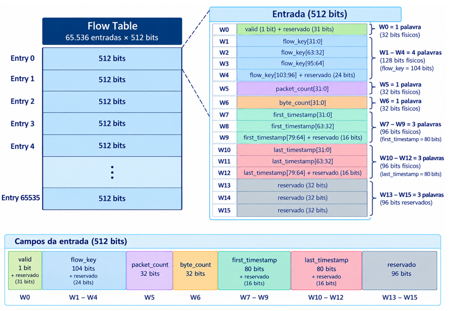

# Especificação da Flow Table — Memória de 32 bits

A Flow Table é uma memória que armazena o estado dos fluxos identificados pelo sistema. Na arquitetura definida, ela possui 65.536 entradas, cada uma associada diretamente a um hash de 16 bits. Cada entrada da Flow Table possui 512 bits, organizados em 16 palavras de 32 bits.

## 1. Organização geral

| Parâmetro | Valor |
|---|---|
| Entrada lógica (registro completo) | 512 bits |
| Palavra física da memória | 32 bits |
| Palavras por entrada | 16 (16 × 32 = 512 bits) |
| Número de entradas | 65.536 |
| Largura do índice hash | 16 bits |
| Profundidade total em palavras | 65.536 × 16 = 1.048.576 palavras |
| Largura do endereço de palavra | 20 bits (2²⁰ palavras) |
| Tamanho total | 65.536 × 512 = 33.554.432 bits = 4 MiB |

### 1.1. Mapeamento dos campos

| Word | Campo armazenado | Largura útil | Observação |
|---|---|---|---|
| W0 | `valid` | 1 bit | Bits [31:1] reservados |
| W1–W4 | `flow_key` | 104 bits | 4 palavras = 128 bits; 24 bits de padding |
| W5 | `packet_count` | 32 bits | Contador de pacotes |
| W6 | `byte_count` | 32 bits | Contador de bytes |
| W7–W9 | `first_timestamp` | 80 bits | 3 palavras = 96 bits; 16 bits de padding |
| W10–W12 | `last_timestamp` | 80 bits | 3 palavras = 96 bits; 16 bits de padding |
| W13–W15 | Reservado | 96 bits | Não utilizado nesta versão |

## 2. Regras de operação

Para cada novo pacote, o Controller usa o hash de 16 bits para selecionar a entrada. Como cada entrada possui 16 palavras de 32 bits, o endereço-base da entrada é calculado por `base_addr = hash_index << 4`, equivalente a `hash_index × 16`. Os endereços das palavras seguintes são `base_addr + word_offset`.

O processamento é dividido em lookup e operação conforme o resultado da consulta.

### 2.1. Lookup

O Controller lê inicialmente W0–W4, que contêm `valid` e `flow_key`. Os demais campos não são lidos durante o lookup.

| Word | Conteúdo |
|---|---|
| W0 | `valid` (bit 0; demais bits reservados) |
| W1 | `flow_key[31:0]` |
| W2 | `flow_key[63:32]` |
| W3 | `flow_key[95:64]` |
| W4 | `flow_key[103:96]` nos bits [7:0]; demais bits reservados |

A decisão do lookup é:

- `valid = 0` → **MISS**
- `valid = 1` e `stored_flow_key = new_flow_key` → **HIT**
- `valid = 1` e `stored_flow_key ≠ new_flow_key` → **COLLISION**

O lookup requer 5 leituras de 32 bits e não realiza escrita na memória.

### 2.2. Criação de novo fluxo — MISS

O Controller monta o registro com os seguintes valores iniciais:

- `valid ← 1`
- `flow_key ← novo flow_key`
- `packet_count ← 1`
- `byte_count ← packet_length`
- `first_timestamp ← timestamp`
- `last_timestamp ← timestamp`

São escritos W0–W12, totalizando 13 escritas. W13–W15 permanecem reservados e não precisam ser escritos nesta operação.

### 2.3. Atualização de fluxo existente — HIT

Após confirmar HIT, o Controller lê W5–W6 para obter `packet_count` e `byte_count`. A atualização é:

- `packet_count ← packet_count + 1`
- `byte_count ← byte_count + packet_length`
- `last_timestamp ← timestamp` do pacote atual

Após os cálculos, são escritos apenas os campos alterados: W5–W6 e W10–W12. Portanto, HIT realiza 2 leituras adicionais e 5 escritas.

### 2.4. Colisão — COLLISION

Quando `valid = 1` e a `flow_key` armazenada é diferente da nova `flow_key`, a entrada não é modificada e o novo fluxo é descartado. A operação realiza 5 leituras e nenhuma escrita.

### 2.5. Resumo das operações de memória

| Resultado | Leituras de lookup | Leituras adicionais | Escritas | Total de operações |
|---|---|---|---|---:|
| MISS | W0–W4 (5) | 0 | W0–W12 (13) | 18 |
| HIT | W0–W4 (5) | W5–W6 (2) | W5–W6 e W10–W12 (5) | 12 |
| COLLISION | W0–W4 (5) | 0 | 0 | 5 |

## 3. Proposta de interface

A interface usa dados e endereços de 32 bits e mantém sinais de solicitação/conclusão de leitura e escrita. Como a memória contém 1.048.576 palavras, são necessários 20 bits para endereçar qualquer palavra.

| Sinal | Direção | Largura | Função |
|---|---|---|---|
| `clk` | Entrada | 1 bit | Clock do sistema |
| `rd_en` | Entrada | 1 bit | Solicita uma leitura |
| `rd_addr` | Entrada | 20 bits | Endereço da palavra de 32 bits a ser lida |
| `rd_data` | Saída | 32 bits | Palavra lida da memória |
| `rd_valid` | Saída | 1 bit | Indica que `rd_data` é válido |
| `wr_en` | Entrada | 1 bit | Solicita uma escrita |
| `wr_addr` | Entrada | 20 bits | Endereço da palavra de 32 bits a ser escrita |
| `wr_data` | Entrada | 32 bits | Palavra a ser escrita |
| `wr_done` | Saída | 1 bit | Indica que a escrita foi concluída |

## 4. Protocolo de operação

### 4.1. Leitura

No ciclo de solicitação, o Controller fornece `rd_en = 1` e `rd_addr = endereço da palavra`. No ciclo seguinte, a Flow Table disponibiliza `rd_valid = 1` e `rd_data` com o conteúdo de 32 bits. Quando `rd_en = 0`, `rd_valid` é desativado.

### 4.2. Escrita

Quando o Controller fornece `wr_en = 1`, `wr_addr` e `wr_data`, a Flow Table grava `mem[wr_addr] <= wr_data` na borda de subida do clock e sinaliza `wr_done = 1`. Quando `wr_en = 0`, `wr_done` é desativado. A implementação abaixo mantém a latência de um ciclo indicada na especificação original.

### 4.3. Exemplo de HIT com `hash_index = 5`

Como cada entrada possui 16 palavras, `base_addr = 5 × 16 = 80`. Assim, a Entry 5 ocupa os endereços 80 a 95.

| Ciclo | `rd_addr` | Word | Campo |
|---|---:|---|---|
| C0 | 80 | W0 | `valid` |
| C1 | 81 | W1 | `flow_key[31:0]` |
| C2 | 82 | W2 | `flow_key[63:32]` |
| C3 | 83 | W3 | `flow_key[95:64]` |
| C4 | 84 | W4 | `flow_key[103:96]` |

Se `valid = 1` e `stored_flow_key = incoming_flow_key`, ocorre HIT. Em seguida, o Controller lê W5–W6 nos endereços 85–86.

### 4.4. Leituras adicionais após HIT

| Ciclo | `rd_addr` | Word | Campo |
|---|---:|---|---|
| C5 | 85 | W5 | `packet_count[31:0]` |
| C6 | 86 | W6 | `byte_count[31:0]` |

### 4.5. Escritas após HIT

Depois de calcular os novos contadores e o timestamp mais recente, o Controller escreve somente os campos alterados.

| Ciclo | `wr_addr` | Word | Campo |
|---|---:|---|---|
| C7 | 85 | W5 | `packet_count` atualizado |
| C8 | 86 | W6 | `byte_count[31:0]` atualizado |
| C9 | 90 | W10 | `last_timestamp[31:0]` atualizado |
| C10 | 91 | W11 | `last_timestamp[63:32]` atualizado |
| C11 | 92 | W12 | `last_timestamp[79:64]` + padding |

A Flow Table confirma cada escrita por meio de `wr_done`. Os ciclos são ilustrativos: o Controller deve aguardar a conclusão de cada operação conforme o protocolo definido.
