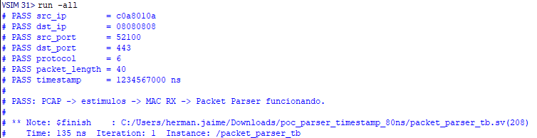
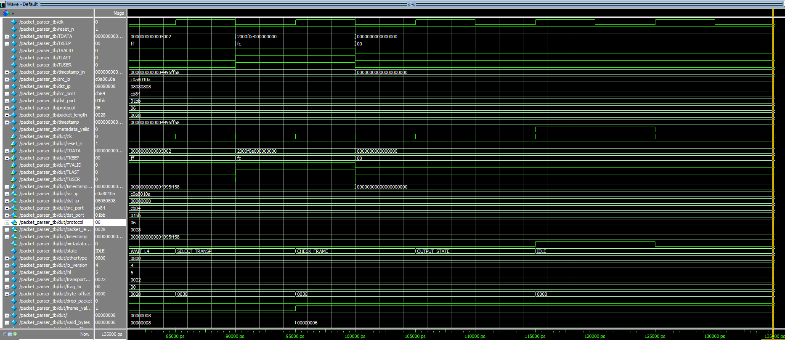

# Relatório de Desenvolvimento — Primeira PoC do Packet Parser

## 1. Objetivo da atividade

Nesta etapa foram desenvolvidos os arquivos necessários para estruturar e validar a primeira prova de conceito funcional do **Packet Parser** no ambiente de simulação.

- `packet_parser.sv`;
- `packet_parser_tb.sv`;
- `create_test_pcap.py`;
- `pcap_to_stimulus.py`;
- `input_stream.txt`.

Também foi realizada a simulação completa no ModelSim, com validação automática dos metadados extraídos.

---

## 2. `create_test_pcap.py`

Foi desenvolvido um script Python responsável por criar um pacote TCP conhecido e armazená-lo em um arquivo PCAP.

O pacote utilizado na PoC possui:

```text
src_ip   = 192.168.1.10
dst_ip   = 8.8.8.8
src_port = 52100
dst_port = 443
protocol = TCP
```

O script gera:

```text
basic_tcp.pcap
```

Para tornar a simulação reproduzível, o timestamp do pacote foi fixado em:

```text
1.234567 s
=
1_234_567_000 ns
```

Esse arquivo serve como entrada controlada para o restante do fluxo de verificação.

---

## 3. `pcap_to_stimulus.py`

Foi desenvolvido um segundo script Python para converter o conteúdo do PCAP em estímulos compatíveis com a interface de entrada do Packet Parser.

O fluxo é:

```text
basic_tcp.pcap
        ↓
pcap_to_stimulus.py
        ↓
input_stream.txt
```

O arquivo gerado utiliza o formato:

```text
TDATA TKEEP TVALID TLAST TUSER TIMESTAMP_HEX
```

A interface considera palavras de 64 bits, com até 8 bytes por ciclo.

Para a última transferência do pacote, como existem seis bytes válidos, foi utilizado:

```text
TKEEP = FC
```

O timestamp do PCAP é convertido para **nanossegundos inteiros** e armazenado em hexadecimal com 20 dígitos, preservando a largura de 80 bits definida na arquitetura.

---

## 4. `input_stream.txt`

Foi gerado o arquivo de estímulos que representa o pacote TCP no formato utilizado pelo testbench.

Conteúdo utilizado na simulação:

```text
TDATA TKEEP TVALID TLAST TUSER TIMESTAMP_HEX
66778899AABB0011 FF 1 0 0 0000000000004995FF58
2233445508004500 FF 1 0 0 0000000000004995FF58
0028000100004006 FF 1 0 0 0000000000004995FF58
A90DC0A8010A0808 FF 1 0 0 0000000000004995FF58
0808CB8401BB0000 FF 1 0 0 0000000000004995FF58
0000000000005002 FF 1 0 0 0000000000004995FF58
2000F0E000000000 FC 1 1 1 0000000000004995FF58
```

Esse arquivo é lido diretamente pelo testbench durante a simulação.

---

## 5. `packet_parser.sv`

Foi desenvolvido o módulo RTL responsável pela extração dos metadados do quadro recebido.

A interface de entrada utiliza:

```text
TDATA
TKEEP
TVALID
TLAST
TUSER
timestamp_in[79:0]
```

O módulo processa:

- Ethernet II;
- IPv4;
- TCP;
- UDP.

Os metadados disponibilizados são:

```text
src_ip[31:0]
dst_ip[31:0]
src_port[15:0]
dst_port[15:0]
protocol[7:0]
packet_length[15:0]
timestamp[79:0]
metadata_valid
```

O Parser também realiza:

- identificação de EtherType `0x0800`;
- verificação de IPv4;
- leitura dinâmica do campo IHL;
- cálculo de `transport_offset`;
- extração das portas TCP/UDP;
- leitura do IPv4 Total Length;
- detecção de fragmentação IPv4;
- descarte de pacotes fora do escopo;
- geração de um pulso de `metadata_valid`.

O timestamp é capturado no início do quadro por meio de `timestamp_in`.

---

## 6. `packet_parser_tb.sv`

Foi desenvolvido o testbench responsável por aplicar os estímulos ao Packet Parser e validar automaticamente os resultados.

O testbench:

- gera o clock;
- aplica o reset;
- abre `input_stream.txt`;
- descarta a linha de cabeçalho;
- lê os seis campos de cada transferência;
- aplica os sinais ao DUT;
- aguarda o pulso de `metadata_valid`;
- compara as saídas obtidas com os valores esperados.

As variáveis `file_tdata`, `file_tkeep`, `file_tvalid`, `file_tlast`, `file_tuser` e `file_timestamp` armazenam temporariamente os valores lidos do arquivo antes de serem aplicados ao DUT.

A variável `header_line` é utilizada apenas para consumir a primeira linha textual:

```text
TDATA TKEEP TVALID TLAST TUSER TIMESTAMP_HEX
```

O timestamp esperado também é obtido do próprio arquivo de estímulos.

Como o timestamp possui 80 bits, o testbench utiliza registradores de 80 bits e realiza a leitura do campo em hexadecimal.

---

## 7. Resultado da simulação

A validação automática confirmou a extração correta dos metadados do pacote TCP.

<p align="center">
  
</p>

Os valores correspondem a:

```text
src_ip        = 192.168.1.10
dst_ip        = 8.8.8.8
src_port      = 52100
dst_port      = 443
protocol      = TCP
packet_length = 40 bytes
timestamp     = 1_234_567_000 ns
```

---

## 8. Verificação da Wave

A Wave foi utilizada para verificar o comportamento temporal da interface e os principais sinais internos do Packet Parser após a adequação do timestamp para 80 bits em nanossegundos.

<p align="center">
  
</p>

A simulação confirmou a propagação correta dos sinais de entrada e dos metadados extraídos pelo Parser.

Durante a última transferência válida do quadro foram observados:

```text
TDATA        = 2000F0E000000000
TKEEP        = FC
TVALID       = 1
TLAST        = 1
TUSER        = 1
timestamp_in = 0000000000004995FF58
```

O valor de `TKEEP = FC` indica seis bytes válidos na última palavra de 64 bits.

Os metadados observados na saída do Parser foram:

```text
src_ip        = C0A8010A
dst_ip        = 08080808
src_port      = CB84
dst_port      = 01BB
protocol      = 06
packet_length = 0028
timestamp     = 0000000000004995FF58
```

que correspondem a:

```text
src_ip        = 192.168.1.10
dst_ip        = 8.8.8.8
src_port      = 52100
dst_port      = 443
protocol      = TCP
packet_length = 40 bytes
timestamp     = 1_234_567_000 ns
```

A Wave também confirmou os principais sinais internos do Parser:

```text
ethertype        = 0800
ip_version       = 4
ihl              = 5
transport_offset = 0022
frag_hi          = 00
drop_packet      = 0
```

O valor:

```text
transport_offset = 0x0022 = 34
```

corresponde ao início da camada de transporte:

```text
14 bytes Ethernet
+
20 bytes IPv4
=
34 bytes
```

O contador `byte_offset` avançou até:

```text
0x0036 = 54 bytes
```

confirmando o processamento completo do quadro Ethernet utilizado na PoC.

A sequência final observada na FSM foi:

```text
WAIT_L4
   ↓
SELECT_TRANSP
   ↓
CHECK_FRAME
   ↓
OUTPUT_STATE
   ↓
IDLE
```

No estado `OUTPUT_STATE`, `metadata_valid` é ativado durante um ciclo, indicando que os metadados estão completos e disponíveis para o próximo módulo.

Em seguida, a FSM retorna ao estado `IDLE`, ficando pronta para receber um novo quadro.

A Wave confirma, portanto, o processamento correto do pacote TCP, a captura do timestamp de 80 bits em nanossegundos e a geração do sinal `metadata_valid` ao final da extração.

---

## 9. Resultado da atividade

Ao final desta etapa foi validado o caminho completo:

```text
create_test_pcap.py
        ↓
basic_tcp.pcap
        ↓
pcap_to_stimulus.py
        ↓
input_stream.txt
        ↓
packet_parser_tb.sv
        ↓
packet_parser.sv
        ↓
metadados extraídos corretamente
```

A primeira PoC do Packet Parser encontra-se funcional para o pacote TCP utilizado no teste e servirá como base para os próximos casos de verificação e para a futura integração com os demais módulos da etapa de Extração de Metadados.

